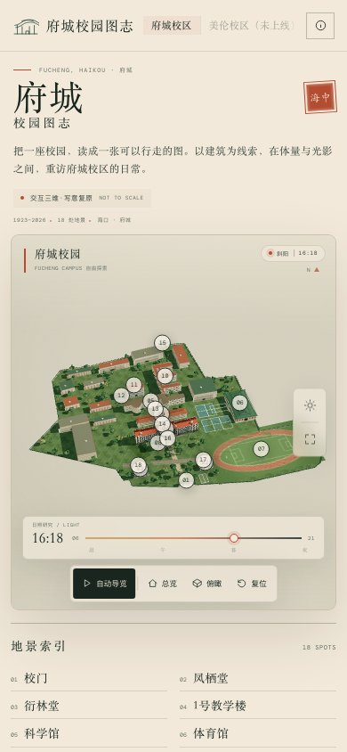

# 府城校园图志 · 海南中学

基于 Three.js 的海南中学府城校区（高中部）交互三维校园。以「校园图志」为视觉概念，将校门、主教学楼、凤栖堂、衍林堂、科学馆、体育馆、图书馆、运动场与百年榄仁树组织成一座可漫游、可阅读的建筑模型。其中**校门、主教学楼、凤栖堂、衍林堂**四座重点建筑按公开照片逐项复原（形制、比例、屋顶、门窗、匾额与庭前雕塑）；**体育馆（大跨平屋面长方体）、操场主席台与蓝黄阶梯看台、国旗、三处连廊、学园「学」字铺地、艺术楼、图书馆、南门**在 2026-11 依据 OpenStreetMap、卫星底图与 2023 年百年校庆影像/航拍逐项修正（详见文末「2026-11 修正与证据」）。并已为**加入其他校区的三维地图**做好架构准备。

> **布局已按真实校园重做。** 建筑轮廓、运动场、篮球场与出入口位置来自 OpenStreetMap 的校园平面数据，并按真实相对位置在三维场景中重建；高度、立面与景观细部为设计推演。

> 本页面为非官方数字文化项目。建筑轮廓来自 OpenStreetMap（ODbL），立面与高度为艺术化推演，不是测绘成果，不用于导航或校园空间决策。**府城校区包含高中部与初中部；本图志目前只绘制高中部，初中部为独立校区、尚未绘制（不在校区切换器中展示，仅在说明中标注）。**

> **多校区就绪。** 校区元数据、空间数据与场景构建器已分层：`js/campuses.js` 是校区注册表，`js/data.js` 是府城校区内容层，`js/site.js` 是府城空间层，`js/campus-accurate.js` 接受 `{campus, site, landmarks, theme}` 参数并提供 `dispose()`。新增校区的完整步骤见 [docs/campuses.md](docs/campuses.md)。


重点建筑在同一页面中 16:18 的最终复原效果（点击查看大图）：

| 校门 | 主教学楼 | 凤栖堂 | 衍林堂 |
| --- | --- | --- | --- |
|  |  |  |  |

2026-11 新增/重做：体育馆（长方体平屋面）、操场主席台与蓝黄阶梯看台（含国旗）：

| 体育馆（平屋面） | 主席台与看台 |
| --- | --- |
|  |  |

2026-11 其他新增：图书馆（位置为推测）与天气系统（下雪）：

| 图书馆 | 下雪 |
| --- | --- |
|  |  |

2026-11 室内与自动巡游影片：

| 主教学楼教室（室内） | 图书馆阅览室 | 影片（01:10 主席台与看台） |
| --- | --- | --- |
|  |  |  |

▶ 85 秒巡游样片：[assets/preview/campus-tour.mp4](assets/preview/campus-tour.mp4)（1152×826，H.264）。录制的视频为纯 3D 画面；页面内播放时另有遮幅、片名、字幕与进度条，也可用 `?film=1&record=1` 自行录制下载。

移动端（390×844）：

## 在线访问

GitHub Pages：<https://leonardo-f.github.io/hainan-middle-school-atlas/>

## 运行

### 直接打开（推荐）

双击或在浏览器中打开 `hainan-middle-school.html`。这是完全自包含的单文件版本：Three.js、字体、样式和程序化贴图全部内联，无需联网，也无需本地服务器。

### 开发版

页面本身是纯静态的；只有「重新生成单文件版」需要 Node 构建依赖（Rollup）：

```bash
npm install
npm run build     # 重新生成 hainan-middle-school.html

python3 -m http.server 8080   # 或 ./serve.sh
```

然后访问 <http://127.0.0.1:8080/>。

也可以使用附带的脚本：

```bash
./serve.sh        # 默认 8080 端口
./serve.sh 9000   # 指定端口
```

> 开发入口 `index.html` 使用 ES Modules 与 import map，需要通过本地 HTTP 服务访问；直接打开请使用 `hainan-middle-school.html`。

## 交互

| 操作 | 说明 |
| --- | --- |
| 拖动 / 单指滑动 | 旋转视角 |
| 滚轮 / 双指捏合 | 缩放 |
| 右键拖动 / 双指拖动 | 平移视角 |
| 点击建筑、编号地标或索引 | 进入对应图志，并飞向该建筑 |
| 自动导览 | 按顺序巡游 08 处校园地景 |
| 日照时刻滑杆 | 调整太阳高度、色温与夜间照明 |
| 数字键 `1`–`8` | 快速定位地标 |
| `T` / `O` / `F` | 导览 / 总览 / 全屏 |
| `Esc` | 关闭图志或暂停导览 |

还支持以下 URL 参数，方便直接分享某个视角：

- `?campus=fucheng`：指定校区（默认即府城；未注册/未上线的校区会回退并提示）
- `?spot=fengqi`：加载后直接打开凤栖堂
- `?hour=19.6`：以指定日照时刻开始（06:00–20:48）
- `?view=top`：以俯瞰视角开始

## 项目特征

- **真实总平面**：运动场在西侧，体育馆在其南侧，教学组团沿校园中部和东侧展开，凤栖堂、衍林堂靠近北门与西北门，南门位于校园南端。
- **门前清理**：校门外的城市道路与北侧门前铺地不再展示，只保留校园内部主路、行道树和围墙。
- **物理检查**：对每个建筑体块、檐口与相邻建筑做了二维轮廓与间距检查。原先被误删的三处「未命名附属块」经卫星叠图与 OSM 邻接关系复核，确认是**连廊本体**（1165596684 / 1165596685 / 1165596686），现已按 OSM 多边形重建为开敞柱廊；科学馆与3号教学楼保留明确缝隙，艺术楼、曲水流觞、手形雕塑、看台、道路均不穿过其他建筑。
- **体育馆体量**：按用户 2026-11 反馈，去掉了上一版屋面上的「半球形」构件（5 道并排半圆筒拱、端部半圆拱面与白色拱肋），改为**长方体平屋面**：浅色大跨墙身、通长横向玻璃带、平屋面 + 女儿墙 + 屋面楼梯间/设备，西南长边保留入口雨棚、台阶、外挂楼梯与「胡文虎体育馆」门额。调研影像中曾出现类似筒拱的拱肋，但用户明确要求去掉，故按写意长方体呈现。
- **操场主席台与看台**：跑道东南直道、体育馆与跑道之间是一条**长直阶梯看台**（10 级，下段蓝色、上段黄色），上方为白色薄顶棚 + 细柱 + 绿藤；**主席台居中**，长条顶棚在主席台两侧断开、不再压住主席台（白色弧形顶、红/蓝座椅、红色背景板）。**只保留一根国旗旗杆**，立在主席台前缘外侧（位置无影像证据，为写意布置）。位置经 Bing WGS84 校准卫星 + 2023 校运会正面/航拍帧复核；看台与体育馆同侧。
- **连廊与学园**：主教学楼↔办公楼两端各一条两层开敞连廊，办公楼↔科学馆在靠体育馆一侧另有一条窄连廊（接科学馆朝校门一侧的突出体块）；两楼之间是「学园」——大面积浅色铺地，中央一方写有「学」字的方场，没有建筑与乔木（按用户 2026-11 的现场描述修正；铺地用项目程序化贴图）。
- **艺术楼**：体量放大并略向东南平移（21×9.5 场景单位、6 层、约 23.5 m），曲水流觞随之让开；白色水平饰带与红瓦坡顶保留，**正门与门廊改朝西北的北门一侧**。不同公开资料对艺术楼层数有出入（另有「地上 3 层、最高 22.85 m」的招标口径），模型按 2015 年资料的写意体量呈现。
- **南门**：复用北门模块（四柱三间、三段绿瓦顶）但**不设石狮**，按围墙缺口缩至 22 m 宽；2015-05-30 竣工（官方大事记）。南门无独立影像可核对，形制为参照北门的写意推定。
- **女生宿舍**：位置尚未确认。2026-11 曾按推测位置重建一栋，但用户指出位置不对，现已**先删除**该体量；待确认真实位置后再补建（东侧原 1444498450 恢复为未命名体块）。
- **初中部**：官方 2023 年新生指南确认初一在**初中部教学楼**报到；初中部是独立校区（位于高中部南侧，约 0.3–0.6 km，不同底图偏移有出入），本图志**未绘制**。按用户 2026-11 反馈，未绘制前不在校区切换器中展示，只在说明对话框中标注「本图志仅绘制高中部；初中部尚未绘制」。
- **图书馆**：新增三层白瓷砖图书馆（绿色玻璃拱形门斗、宽台阶、屋顶银色穹顶圆塔）；该建筑未见于 OSM 轮廓，位置与轮廓为依据 2023 年校庆影像与卫星图推测的写意位置（置信度中低，非测绘）。
- **教学楼命名**：按用户 2026-11 反馈，1 号教学楼改为**主教学楼**、2 号教学楼改为**办公楼**、第 3 教学楼改为**3号教学楼**；地标、索引、小地图与场景标签同步。
- **天气系统**：日照面板下方新增天气滑杆「晴 / 小雨 / 暴雨 / 台风 / 雷雨 / 下雪」；雨幕、暴雨、台风斜雨、雷雨闪电、雪天雪花与地面积雪均为纯前端程序化效果，并保持昼夜时刻联动。
- **编号默认隐藏**：场景中的建筑编号标记默认隐藏，点击建筑、索引或导览时只显示当前选中地标的编号与名称，关闭图志后再次隐藏。
- **学生与校服**：在主要建筑、庭院、校门附近布置男女学生步行路线，并在运动场红色跑道上安排 16 名男女学生跑步；校服按学校公开的夏季运动套装还原为白色短袖、青绿色领口/袖口/裤侧条与白鞋，少量学生着白色正装衬衫、深色西裤/白裙。参考：[海南中学校服选购说明](http://www.jlgjzx.com/haizhong/2026-08/03/article_2026080316203796381.html)。
- **室内场景**：主教学楼首层（门厅、走廊、教室，含黑板/课桌椅/窗带/吊灯）、图书馆首层阅览室（书架、阅览长桌、台灯、高窗）、凤栖堂厅堂（红柱、梁架、匾额、条案、展柜、灯笼）；均为低模写意室内，用于自动影片穿行和近距离观察。
- **自动巡游影片**：点击底部「影片」进入约 85 秒的电影式巡游（30 段：高空入校 → 北门 → 凤栖堂内外 → 主教学楼门厅/走廊/教室 → 图书馆内外 → 科学馆/艺术楼 → 体育馆/看台/运动场 → 升空收尾），带遮幅、片名、中英字幕与进度条；播放中可「录制并下载」为 WebM，也可用 `?film=1&record=1` 无人值守自动出片。样片见 `assets/preview/campus-tour.mp4`。
- **学生天气行为**：下雨时约一半步行学生撑伞继续走、其余（含跑道跑步学生）小跑到最近避雨点（主教学楼门廊、办公楼连廊、科学馆入口、凤栖堂/衍林堂檐廊、图书馆门廊、体育馆雨棚、主席台顶棚）待机，雨停后回到原路线；雪天不打伞、略减速；所有学生逐帧避让 21 栋建筑轮廓与校园红线，不再穿模。
- **统一索引**：所有名称统一收进「地景索引」；主教学楼、3号教学楼、艺术楼、曲水流觞、手形雕塑、学园、南门、图书馆等均可在索引中点开。场景编号默认隐藏，点击建筑后才显示当前项的编号与名称。虎踞龙盘太湖石、凤栖堂夫子像、衍林堂「春风化雨」铜像也作为独立雕塑条目收录。
- **百年古树**：与「虎踞龙盘」太湖石同一排，位于校门左侧、主楼右前方；按巨大榕状树冠、垂落气根表现，树下设置石桌与四个石凳。
- **细节校正**：校门后不设第二道牌坊；衍林堂前为「春风化雨」钟衍林与学生铜像；凤栖堂前为夫子像，庭院使用灰色石板铺地；主教学楼前广场置「虎踞龙盘」太湖石；主教学楼与办公楼之间为「学园」；校园以一条北门—凤栖堂—主教学楼主轴连接，不再铺设分叉路网。
- **科学馆与艺术楼**：科学馆改用其真实 OSM 多边形轮廓并轻微内收，与3号教学楼留出清晰缝隙；3号教学楼也改用真实轮廓并补上真实轮廓上的横向窗带、屋顶楼梯间与红瓦檐口；艺术楼放大后移到科学馆后侧、更靠近东南侧的空隙，避免与科学馆、3号教学楼穿插。
- **教学组团细节**：主教学楼补上中央塔楼、两端红瓦亭与入口台阶；办公楼补上连续柱廊；主教学楼与3号教学楼之间补上手形雕塑、学园、连廊与庭院绿化。细节参考海南中学官方校园图集。
- **曲水流觞**：艺术楼旁新增蜿蜒水庭，包含五段水池、石岸、小石桥、立石题名，以及芦苇与睡莲。
- **单一主轴**：校门至主教学楼正门只保留一条直达主干道，不经过凤栖堂，也不再铺设交叉支路。
- **可读的体量**：教学楼、科学馆、体育馆与生活建筑按 OSM 轮廓和实际方位布置。
- **四座重点建筑的深度复原**：校门（四柱三间、三段曲面绿瓦顶、右读「海南中學」门额、四只石狮、围墙返段）、1 号教学楼（五层长楼、五段红瓦屋顶、深色石材「1923」门架、红色抱厦、楼前太湖石）、凤栖堂（两重绿琉璃瓦檐、六柱红金檐廊、黄色透花栏板、夫子像）、衍林堂（两层白墙、绿色曲面双坡顶与白色山墙、腰檐、红木格窗、露台红栏、「春风化雨」群像）。四座建筑均为独立模块（`js/landmarks/*.js`），按真实尺度以「米」建模后统一换算到场景单位，并按材质合并网格控制开销。
- **程序化细节**：屋瓦、铺地、立面窗格、匾额、跑道、地形材质均由 Canvas 实时绘制，没有外部贴图依赖。
- **昼夜研究**：太阳角度、天空渐变、长阴影、窗光与路灯随时刻连续变化；阴影贴图仅在时刻变化时重新计算。
- **轻量交互叙事**：地景索引、三维编号标记、小地图、建筑信息卡、自动导览与可访问的移动端抽屉。
- **响应式**：桌面端为环景式图志界面；手机端使用横向地标滑动条、编号地标与底部信息抽屉，并自动重新取景。

## 2026-11 修正与证据

本轮修正以 **OpenStreetMap 轮廓（ODbL）** + **Bing WGS84 校准卫星底图** + **B 站 2023 年百年校庆影像/航拍**为主要依据，逐项核对后重做：

| 修正项 | 结论 / 做法 | 依据与置信度 |
| --- | --- | --- |
| 国旗、校旗 | 移到操场主席台前缘，两根（国旗高、校旗低），校旗为红底 + 圆形校徽写意复刻 | 无旗杆影像证据；位置为写意 |
| 主席台、看台 | 跑道东南直道（体育馆与跑道之间）长直看台；**主席台居中**、顶棚在两侧断开；10 级蓝/黄阶梯、白顶棚 + 细柱 + 绿藤；**只保留国旗**，旧版弧形看台与单旗已删除 | 2023 校运会正面/航拍帧 + Bing WGS84 叠图；形制高置信度，旗杆/长度为写意 |
| 体育馆 | 去掉前一版的 5 道半圆筒拱、端部半圆拱面与白色拱肋，改为长方体平屋面（浅色大跨墙身 + 横向玻璃带 + 女儿墙 + 屋面设备/楼梯间，保留入口雨棚/外挂楼梯/门额） | 用户 2026-11 反馈；形制为写意 |
| 凤栖堂夫子像 | 移到正门中轴 x=0、台基与台阶外、距门约 5 m，面向庭院（背对建筑） | 官方 2024 正面照 + 宣传片帧；对位/朝向高置信度 |
| 衍林堂「春风化雨」群像 | 保持中轴，距离校正为距前墙 5.0 m、基座完全在台基与台阶之外，面向庭院 | 宣传片正面帧 + 航拍；高置信度 |
| 1 号↔2 号、2 号↔科学馆连廊 | 复用 OSM 1165596684 / 1165596685 / 1165596686（被误删的「重叠附属块」实为连廊），重建为两层开敞柱廊 + 坡瓦顶盖 | OSM 多边形 + 卫星邻接关系；中置信度 |
| 学园 | 主教学楼/办公楼之间大面积铺地 + 中央「学」字方场，无建筑与乔木 | 用户 2026-11 现场描述；铺地用既有程序化贴图 |
| 艺术楼 | 放大为 21×9.5 单位、6 层约 23.5 m，正门与门廊朝西北的北门一侧；曲水流觞让开 | 2015 年公开资料 + 2023 影像；位置为写意（另有「地上 3 层、最高 22.85 m」口径） |
| 南门 | 复用北门四柱三间形制、无石狮、22 m 宽；2015-05-30 竣工 | 官方大事记（竣工日期）；无实拍，形制为推定 |
| 女生宿舍 | 位置未确认：上一版推测位置的体量已删除，暂不标注 | 用户 2026-11 反馈 |
| 室内场景 | 主教学楼首层门厅/走廊/教室、图书馆阅览室、凤栖堂厅堂低模室内与相机机位 | 用户 2026-11 需求；形制为写意 |
| 自动巡游影片 | 85 s 电影式巡游（30 段，含建筑室内段与压黑转场），支持 `?film=1` 播放、录制下载 WebM、`?film=1&record=1` 自动出片；样片 `assets/preview/campus-tour.mp4` | 自研脚本；相机路径为写意 |
| 学生天气行为 | 雨天打伞/躲雨状态机 + 21 栋建筑碰撞推回；雪天无伞 | 用户 2026-11 反馈；行为逻辑为写意 |
| 图书馆 | 新增三层白瓷砖图书馆（绿色玻璃拱形门斗、银色穹顶圆塔、宽台阶），位置为推测 | 2023 年校庆影像 + Bing 卫星；位置置信度中低 |
| 教学楼命名 | 1号→主教学楼、2号→办公楼、第3→3号教学楼 | 用户 2026-11 反馈 |
| 食堂 | **未能确认**：卫星上 OSM 体育馆正南为 OSM 未收录小楼与校内菜地，食堂更可能在东侧宿舍区，故不标注、不建体量 | 无可靠证据 |
| 初中部 | 独立校区，本图志未绘制；**不在校区切换器展示**，仅在说明中标注 | 2023 级新生指南 + 地图 POI；位置精度有限 |
| 排球场 | 凤栖堂与校门之间的现有排球场位置正确，保留 1 片 | 官方《凤栖堂修缮工程总平面图 1:500》显示该区域有 4 片球场/活动场地 |

证据链接（部分）：

- B 站百年校庆官方宣传片（转载）：<https://www.bilibili.com/video/BV1dh4y117nV>
- B 站「航拍海中」校友航拍：<https://www.bilibili.com/video/BV1uC4y1J7R>
- B 站 2023 年校庆 VLOG（体育馆近景等）：<https://www.bilibili.com/video/BV13z4y1N7EH>
- 海南中学 2023 年新生入学指南（府城校区高中部/初中部报到安排）：<https://www.haizhong.edu.cn/haizhong/2023-08/19/article_2023081920294774056.html>
- 海南中学凤栖堂修缮工程方案设计（含 1:500 总平面图）：<https://www.haizhong.edu.cn/haizhong/2026-09/30/93b940346c1646f7914f3a66fa3f229d/2026100122220326696.pdf>
- OpenStreetMap 校园轮廓：<https://www.openstreetmap.org/way/1127981105>

> **未解决 / 写意项**：国旗旗杆的真实位置与高度、南门实拍、食堂位置与「体育馆—食堂—初中部」道路、看台精确长度、艺术楼真实位置与层数、图书馆真实位置与馆舍信息，均无足够公开证据；模型中的对应处理均为写意，不等同于实测。

## 技术

- Three.js r169（`vendor/three.module.js`，MIT）
- `OrbitControls`
- 原生 JavaScript、CSS、Canvas 2D
- 开发版由浏览器原生 ES Modules 直接运行；单文件版由 Rollup 打包并内联字体、样式
- 页面运行时无第三方网络请求

主要文件：

```text
index.html                 页面结构与图志内容容器
hainan-middle-school.html  完全自包含单文件版（可直接双击打开）
css/style.css              版式、响应式与主题
js/main.js                 相机、UI、交互、昼夜与导览
js/site.js                 由 OSM 整理的真实校园轮廓、建筑、运动场与道路数据
js/campus-accurate.js      按真实总平面搭建的三维校园场景（可接受校区参数，含 dispose）
js/campus.js               可复用的材质、植被与建筑构件函数
js/textures.js             程序化贴图与立面绘制
js/data.js                 府城校区内容层：校区身份、地标索引、叙事文本与取景参数
js/campuses.js             校区注册表、?campus= URL 契约与数据校验
js/landmarks/parts.js      四座重点建筑共享的中式构件库（曲面瓦顶、门窗、石狮、栏杆、合并收尾）
js/landmarks/gate.js       校门模型（米制，独立模块）
js/landmarks/teaching.js   1 号教学楼模型（米制，独立模块）
js/landmarks/fengqi.js     凤栖堂模型（米制，独立模块）
js/landmarks/yanlin.js     衍林堂模型（米制，独立模块）
tools/model-preview.html   单栋建筑快速预览器（开发工具，不参与正式构建）
docs/campuses.md           多校区扩展与新增校区指南
build.mjs                  单文件版构建脚本
vendor/                    Three.js 与 OrbitControls
assets/fonts/              Latin UI 字体
assets/preview/            页面预览图
```

## 重点建筑的建模工作流

四座重点建筑位于 `js/landmarks/`，遵循同一套约定：

- 模块内部一律使用**米**（与照片、官方资料、参考作品一致），建筑局部坐标 +z 为正面；
- `build(ctx)` 返回一个 `THREE.Group`，末尾用 `finalize()` 换算到场景单位（1 场景单位 ≈ 2 米）、按材质合并静态网格、统一开启阴影；
- 集成由 `js/campus-accurate.js` 按 OSM 中心点与长边角放置，并注册拾取与地标；
- 共享构件（曲面瓦顶、双坡顶、窗、石狮、栏杆、浮雕带等）集中在 `js/landmarks/parts.js`。

单独预览一栋建筑（开发时比加载整个校园快得多）：

```text
http://127.0.0.1:8080/tools/model-preview.html?model=gate&view=front
model = gate | teaching | fengqi | yanlin
view  = front | persp | aerial | side | back
```

参考照片（不随页面分发，仅作复原依据）：校门与轴线照片来自 Wikimedia Commons（CC0，2013 年，Anna Frodesiak）；凤栖堂、衍林堂、1 号教学楼照片来自学校官网公开页面与用户提供的航拍照，页面内不复用这些照片。

## 资料与复原说明

校园空间数据：

- 建筑轮廓、运动场、篮球场与出入口：[OpenStreetMap](https://www.openstreetmap.org/way/1127981105)，© OpenStreetMap contributors，ODbL 1.0。项目将 OSM 数据转换为本地场景坐标，建筑高度、立面、屋顶、植被与部分公共空间为设计推演。

史实与建筑形制主要参考以下资料：

1. [海南日报：《一所中学的一个世纪 百年海中恰芳华》](https://www.hinews.cn/news/system/2023/10/30/033065555.shtml)，2023-10-30。
2. [海南中学凤栖堂修缮工程方案设计（官方公示 PDF）](https://www.haizhong.edu.cn/haizhong/2026-09/30/93b940346c1646f7914f3a66fa3f229d/2026100122220326696.pdf)，包含凤栖堂 1934 年建成、面宽 22.1 米、进深 12.5 米、省级文物保护单位等信息。
3. [海南日报《百年海中恰芳华》校门报道](https://news.hndaily.cn/h5/html5/2023-10/30/content_58477_16668430.htm)，包含校门形制与商承祚题写校名的线索。
4. [海南中学校园景观简介](https://www.haizhong.edu.cn/eportal/ui?pageId=8e153c4caa2f4f03b152da17e025da81&articleKey=817888f979f34a5db0a495727198d42d&columnId=8e153c4caa2f4f03b152da17e025da81)，包含“一池两馆三园”、学园、太湖石“虎踞龙盘”等信息。
5. [中国建筑标准设计研究院：海南中学艺术楼](http://www.cbs.com.cn/case/202004241761.html)，2015 年设计，建筑面积 7000 平方米，建筑高度 23.5 米。
6. [海南中学官方校园图集：校园美景](https://www.haizhong.edu.cn/eportal/ui?pageId=db1485012de84281993fd96f0c31e340&articleKey=db7aa27feeb74681a19dd966317744d3&columnId=8e153c4caa2f4f03b152da17e025da81)，含手形雕塑、石桌石凳、连廊、水庭与教学组团照片。

模型不追求建筑测绘级别的准确性：

- 校园总平面依据真实 OSM 数据整理；建筑轮廓可能有简化，个别建筑的外轮廓以教学组团体量近似；
- 校门、1 号教学楼、凤栖堂、衍林堂四座重点建筑按公开照片逐项复原；其余建筑的立面与屋顶细节为设计推演；
- 树木、人物、道路铺装和室内光效均用于氛围与尺度表达。

如果需要用于正式宣传、导览或校园空间展示，建议以学校官方资料、实测图纸和授权影像进一步校核。

### 延伸阅读

- [视频还原建筑模型（可交互）调研](docs/ai-video-reconstruction.md)：2026-11 的 3DGS/结构化重建/交互式世界模型现状、可用工具，以及接入本图志的可行路线。

