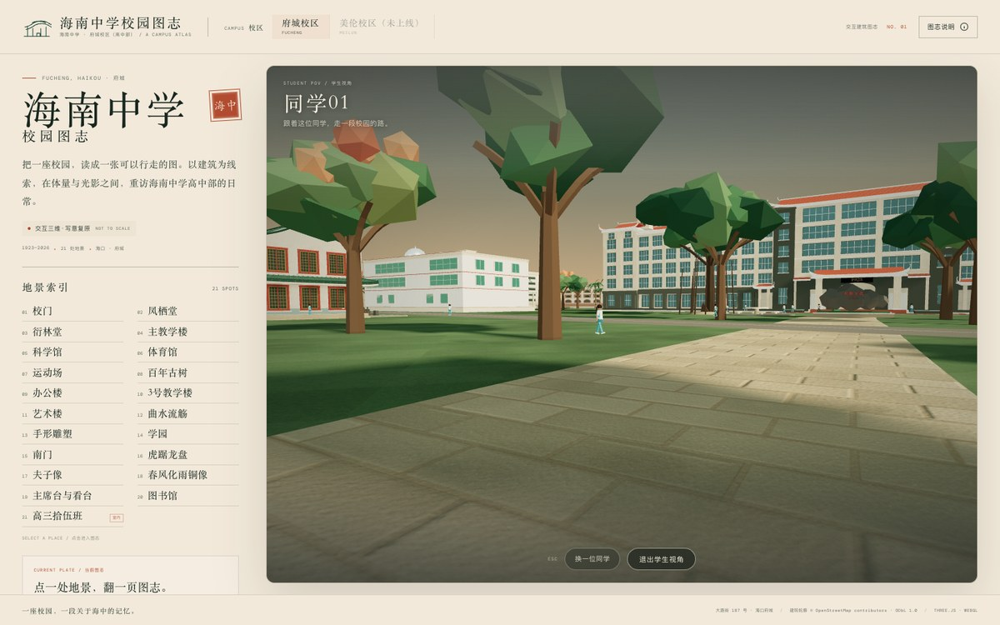
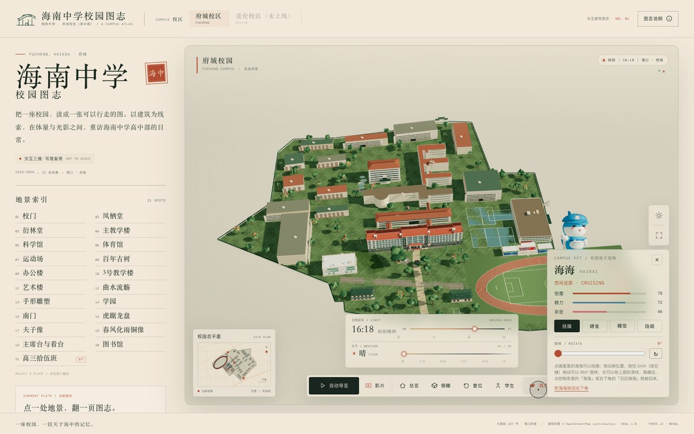

# 海南中学校园图志 · 府城校区

**中文** | [English](README_EN.md)

基于 Three.js 的海南中学府城校区（高中部）交互三维校园图志：把一座校园，读成一张可以行走的图。以建筑为线索，在体量与光影之间，重访府城校区的日常。

**在线访问**：<https://leonardo-f.github.io/hainan-middle-school-atlas/>

**单文件版**：`hainan-middle-school.html`


> 校园总平面参考 OpenStreetMap 轮廓与公开影像整理；校门、主教学楼、凤栖堂、衍林堂四座重点建筑依据公开照片与官方资料按形制与米制尺度复原，其余建筑的体量与立面为设计推演。**非测绘成果，不用于导航、测量或校园空间决策**，逐条边界见 [docs/accuracy.md](docs/accuracy.md)。本项目为非官方数字文化项目，与海南中学无隶属关系；府城校区含高中部与初中部，本图志**仅绘制高中部**。

**本期新增**：每处地景配一张实景照片（双击放大）；主教学楼顶楼左翼的「高三拾伍班」教室独立成页，室内定点环视不穿墙；直接单击画面里的同学（或按控制条「学生」进入点选模式）即可切到第一人称视角；「换一位同学」会随机换人，学生也会偶尔离开固定路线随机走一段；「海海」按实体玩偶重做并缩小，默认关闭、点控制条开启，可拖动换位、360° 旋转。

## 图集

| 校门 | 主教学楼 |
| --- | --- |
|  |  |
| **凤栖堂** | **衍林堂** |
|  |  |
| **高三拾伍班（室内）** | **学生视角** |
|  |  |
| **图书馆阅览室（室内）** | **宠物面板（抚摸 / 喂食 / 睡觉 / 360° 旋转）** |
|  |  |
| **夜景** | **下雪** |
|  |  |

每处地景的图志页都配有一张实景照片（详见下方「实景照片」）。

## 巡游影片

约 74 秒的电影式巡游：高空入校 → 北门 → 凤栖堂外景 → 主教学楼（门厅 / 走廊 / 高三拾伍班）→ 图书馆（外景 / 阅览室）→ 科学馆与艺术楼 → 体育馆 / 看台 / 运动场 → 升空收尾。页面底部「影片」可直接播放，也可录制下载 WebM。

[](assets/preview/campus-tour.mp4)

## 快速开始

```bash
# 直接打开：双击 hainan-middle-school.html（自包含单文件，无需联网）
npm install
npm run serve      # 开发版 http://127.0.0.1:8080/（需 HTTP，ES Modules + import map）
npm run build      # 重新生成自包含单文件版
npm run shots      # 视觉回归门控（shots:update 重建基准）
```

URL 参数：`?campus=fucheng` · `?spot=fengqi` · `?spot=classroom` · `?hour=19.6` · `?view=top` · `?film=1` · `?weather=snow`；开发参数 `?still=1&nointro=1`、`?env=off`、`?detail=off`、`?pet=on/off`。

## 实景照片

图志中的 21 处地景各配一张实景照片，点击建筑后出现在左侧图志卡中；标注「实景」的是该地景的直接照片，标注「参考」的是同一片区/同款形制的对照照片（例如南门暂无公开实拍，以同款北门作参考）。

- 主要来源：海南中学官网校园风景图集（2013，陈小雄 摄）、B 站百年校庆宣传片与《航拍海中》（2023）、《海南中学！！来自上帝视角》（2018）。
- 照片版权归原作者与学校所有，本项目仅作非官方校园阅读与史实对照，不用于商业传播；如涉版权请联系删除。
- 照片会随单文件版一起内联，离线打开也能看到；开发版位于 `assets/photos/`。

## 文档

- **功能与实现**：[功能一览](docs/features.md) · [电子宠物](docs/pet.md) · [开发与构建](docs/contributing.md) · [完整目录](docs/structure.md)
- **精度与设计**：[精度与证据](docs/accuracy.md) · [设计注记](docs/design-notes.md) · [变更记录](docs/changelog.md)
- **工程工具**：[视觉回归](docs/visual-regression.md) · [多校区扩展](docs/campuses.md)
- **相关调研**：[AI 生成 3D 网页游戏](docs/ai-generated-3d-games.md) · [视频还原建筑模型](docs/ai-video-reconstruction.md)

## 注意事项

- **数据与素材**：校园空间数据来自 [OpenStreetMap](https://www.openstreetmap.org/way/1127981105)（© OpenStreetMap contributors，[ODbL 1.0](https://opendatacommons.org/licenses/odbl/1-0/)）；字体按 SIL OFL 1.1；预览图与巡游样片为本项目渲染输出。
- 校名、「海中」等学校标识权利归学校所有；正式用于宣传、导览或空间决策前，请以学校官方资料与实测图纸为准。
