# 府城校园图志 · 海南中学

基于 Three.js 的海南中学府城校区（高中部）交互三维校园图志：把一座校园，读成一张可以行走的图。以建筑为线索，在体量与光影之间，重访府城校区的日常。

**在线访问**：<https://leonardo-f.github.io/hainan-middle-school-atlas/> · **单文件版**：`hainan-middle-school.html`（双击即开）

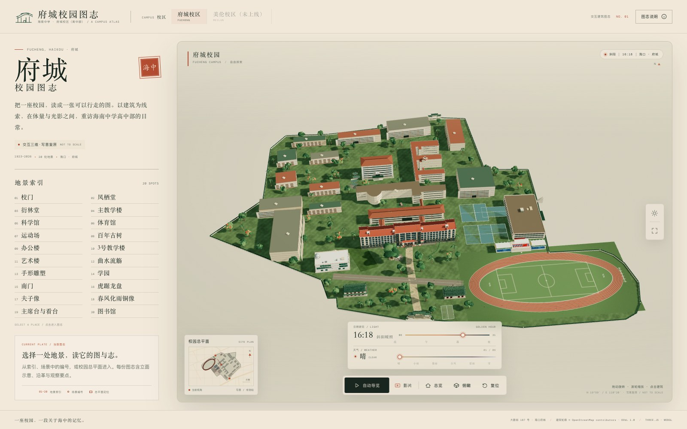

> 校园总平面参考 OpenStreetMap 轮廓与公开影像整理；校门、主教学楼、凤栖堂、衍林堂四座重点建筑依据公开照片与官方资料按形制与米制尺度复原，其余建筑的体量与立面为设计推演。**非测绘成果，不用于导航、测量或校园空间决策**，逐条边界见 [docs/accuracy.md](docs/accuracy.md)。本项目为非官方数字文化项目，与海南中学无隶属关系；府城校区含高中部与初中部，本图志**仅绘制高中部**。

## 图集

| 校门 | 主教学楼 |
| --- | --- |
| 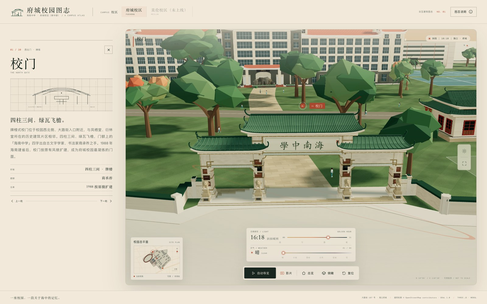 | 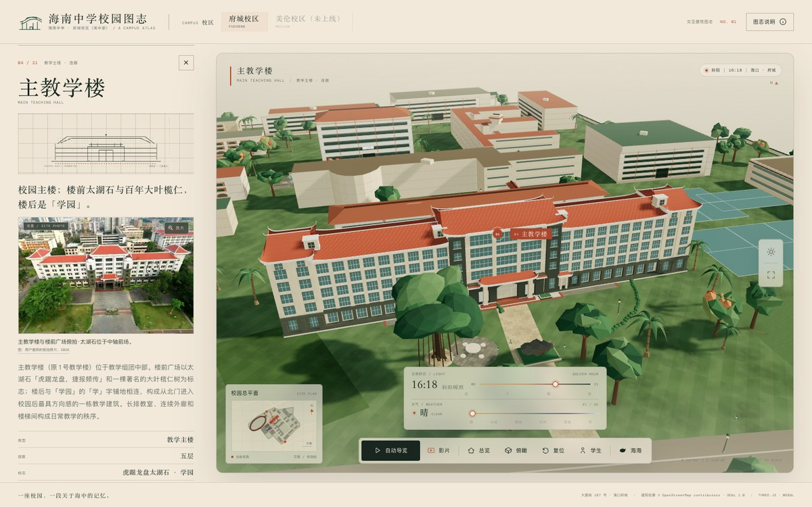 |
| **凤栖堂** | **衍林堂** |
| 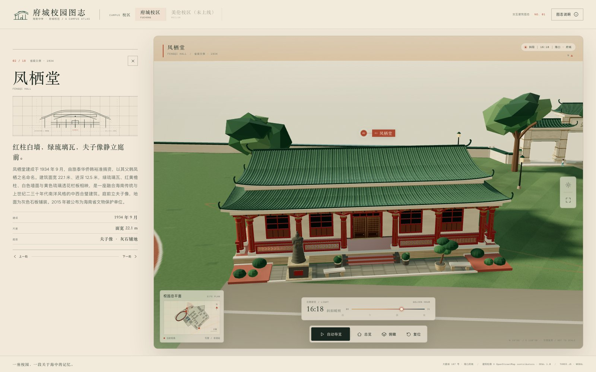 |  |
| **图书馆** | **体育馆（平屋面）** |
| 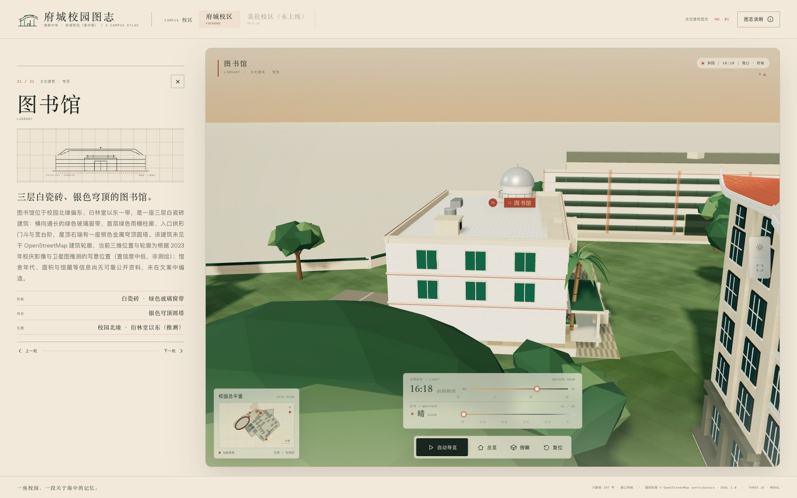 | 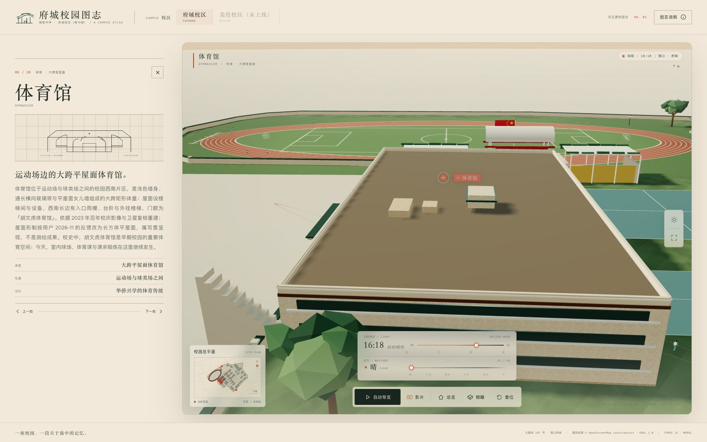 |
| **操场主席台与看台** | **主教学楼教室（室内）** |
|  | 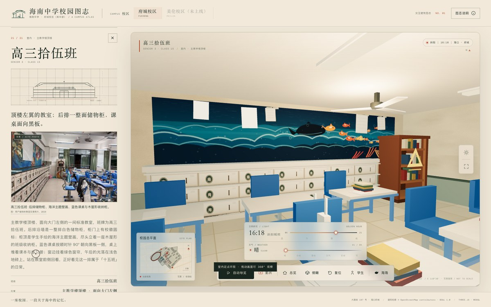 |
| **图书馆阅览室（室内）** | **凤栖堂厅堂（室内）** |
| 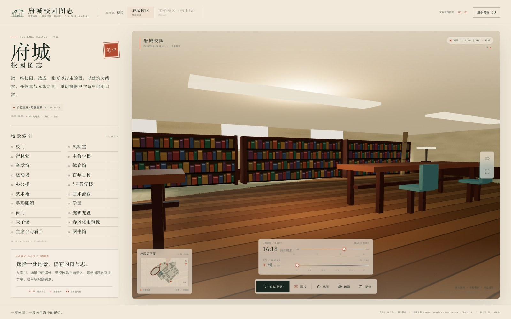 |  |
| **夜景** | **下雪** |
| 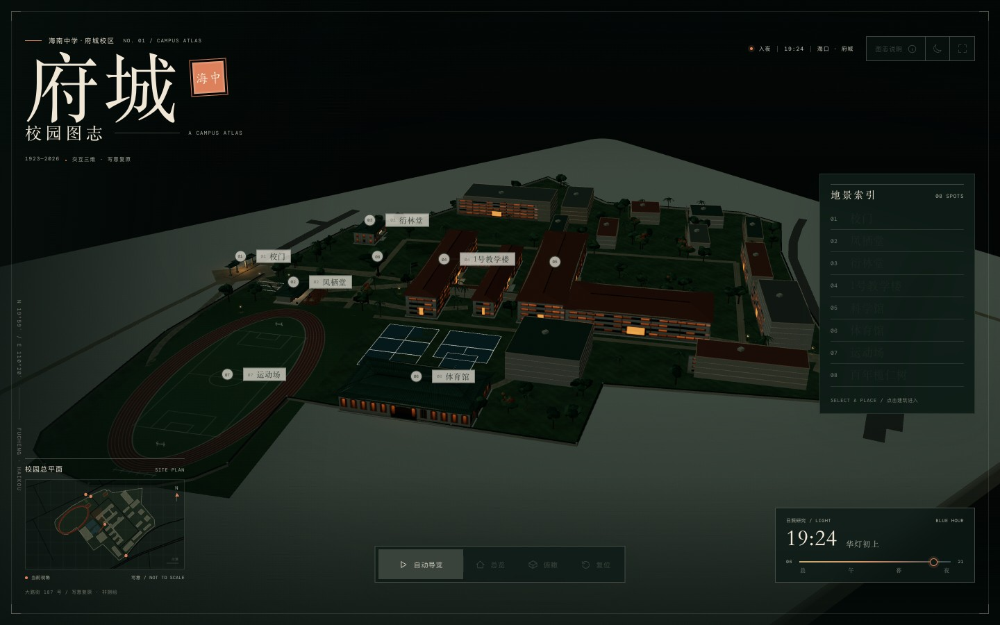 | 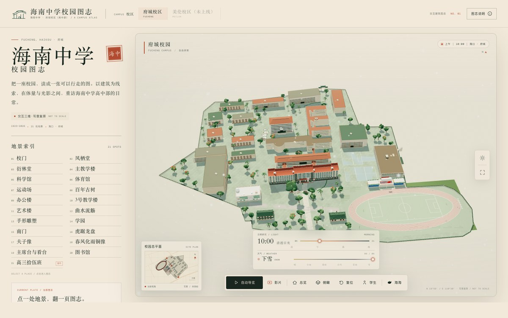 |

**巡游影片**：约 85 秒的电影式巡游，含室内穿行、遮幅与中英字幕；页面底部「影片」播放，[样片](assets/preview/campus-tour.mp4)（1152×826，H.264）。

[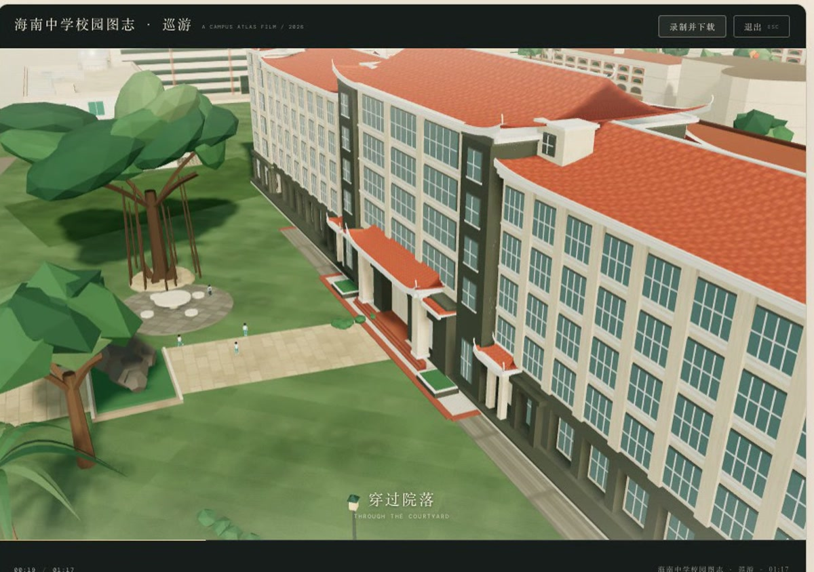](assets/preview/campus-tour.mp4)

## 快速开始

```bash
# 直接打开：双击 hainan-middle-school.html（自包含单文件，无需联网）
npm install
npm run serve      # 开发版 http://127.0.0.1:8080/（需 HTTP，ES Modules + import map）
npm run build      # 重新生成自包含单文件版
npm run shots      # 视觉回归门控（shots:update 重建基准）
```

URL 参数：`?campus=fucheng` · `?spot=fengqi` · `?hour=19.6` · `?view=top` · `?film=1` · `?weather=snow`；开发参数 `?still=1&nointro=1`、`?env=off`、`?detail=off`。

## 文档

- **功能与实现**：[功能一览](docs/features.md) · [开发与构建](docs/contributing.md) · [完整目录](docs/structure.md)
- **精度与设计**：[精度与证据](docs/accuracy.md) · [设计注记](docs/design-notes.md) · [变更记录](docs/changelog.md)
- **工程工具**：[视觉回归](docs/visual-regression.md) · [多校区扩展](docs/campuses.md)
- **相关调研**：[AI 生成 3D 网页游戏](docs/ai-generated-3d-games.md) · [视频还原建筑模型](docs/ai-video-reconstruction.md)

## 注意事项

- **数据与素材**：校园空间数据来自 [OpenStreetMap](https://www.openstreetmap.org/way/1127981105)（© OpenStreetMap contributors，[ODbL 1.0](https://opendatacommons.org/licenses/odbl/1-0/)）；字体按 SIL OFL 1.1；预览图与样片为本项目渲染输出。
- 校名、「海中」等学校标识权利归学校所有；正式用于宣传、导览或空间决策前，请以学校官方资料与实测图纸为准。
