# Hainan Middle School Campus Atlas · Fucheng Campus

**English** | [中文](README.md)

An interactive 3D campus atlas of Hainan Middle School (Fucheng campus, senior high section), built with Three.js: read a campus as a map you can walk through, revisiting its everyday spaces through buildings, massing, and light.

**Live site**: <https://leonardo-f.github.io/hainan-middle-school-atlas/>

**Single-file build**: `hainan-middle-school.html`

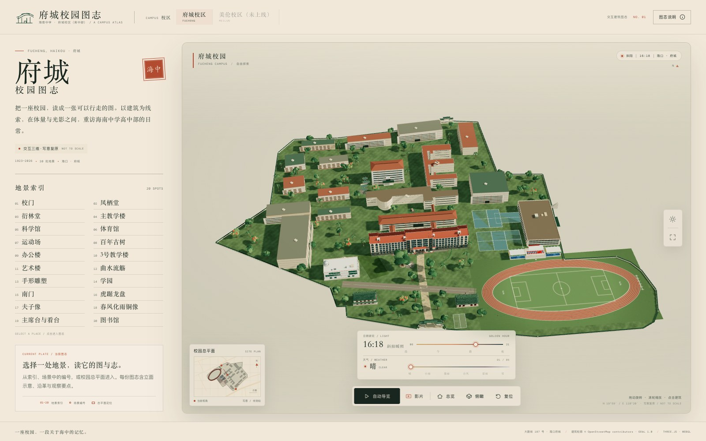

> The campus plan is based on the OpenStreetMap outline and public imagery. Four key buildings — the North Gate, Main Teaching Building, Fengqi Hall, and Yanlin Hall — are reconstructed from public photographs and official materials using their architectural form and metric scale; other volumes and façades are design inferences. **This is not a survey product and must not be used for navigation, measurement, or campus planning decisions.** See [docs/accuracy.md](docs/accuracy.md) for the evidence boundaries. This is an unofficial digital culture project and is not affiliated with Hainan Middle School. The Fucheng campus includes both senior high and junior high sections; this atlas covers the **senior high section only**.

**What's new in this round**: every landmark now has a real photograph (double-click to enlarge); the "Senior 3, Class 15" classroom on the top floor of the left wing is a standalone entry with a fixed-position 360° interior view that does not clip through walls; single-click any student (or use the "Students" mode in the dock) to enter first-person follow; "Change student" now picks a different student at random, and students occasionally leave their fixed route for a short random walk; Haibai the mascot has been rebuilt and scaled down, is off by default, turns on from the dock, can be dragged, and rotates 360°; the loading page now includes a school-badge mark, and "Replay opening" on the home page reopens the loading page.

## Gallery

| North Gate | Main Teaching Building |
| --- | --- |
| 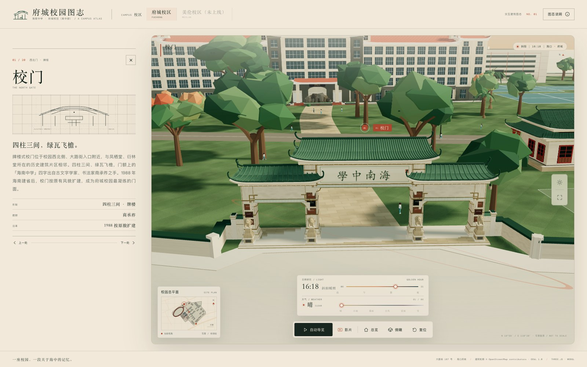 | 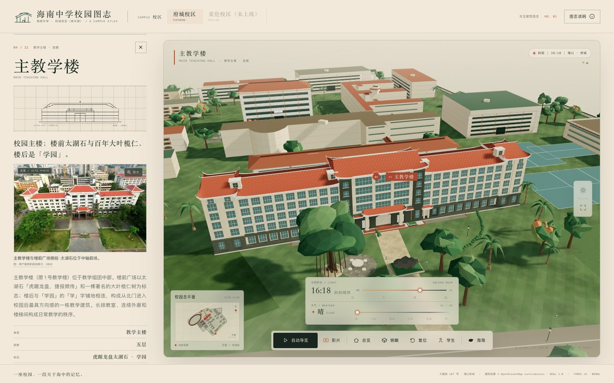 |
| **Fengqi Hall** | **Yanlin Hall** |
| 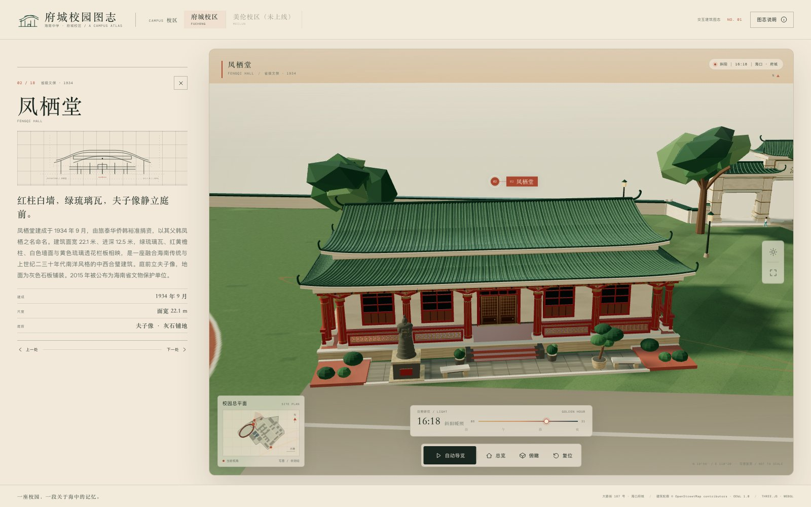 | 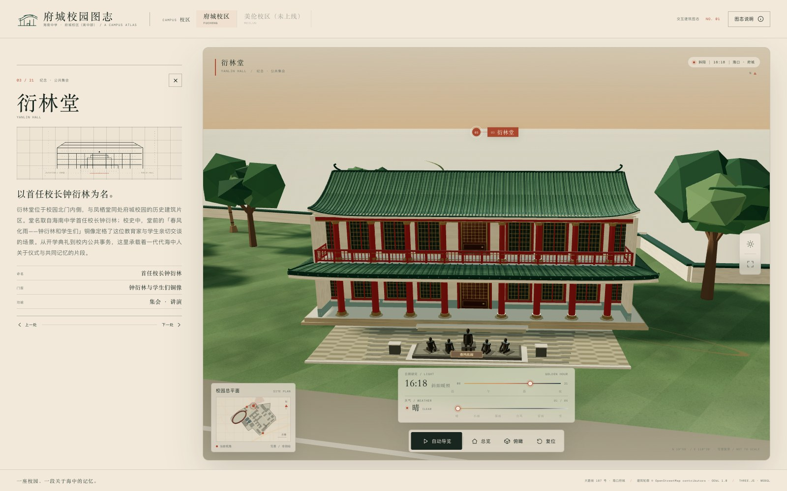 |
| **Senior 3, Class 15 (interior)** | **Student POV** |
| 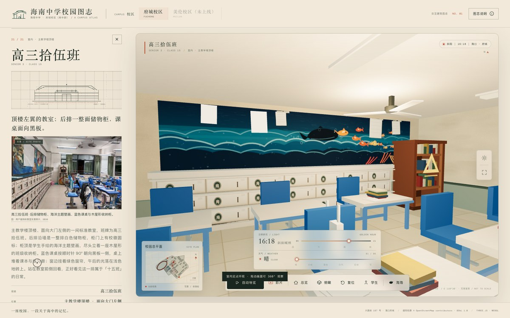 | 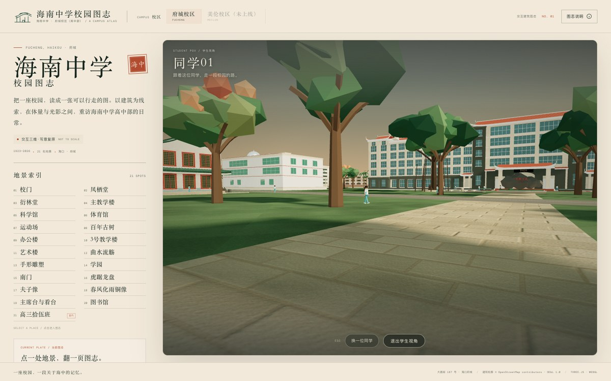 |
| **Library reading room (interior)** | **Companion panel (pet / feed / sleep / 360° rotate)** |
| 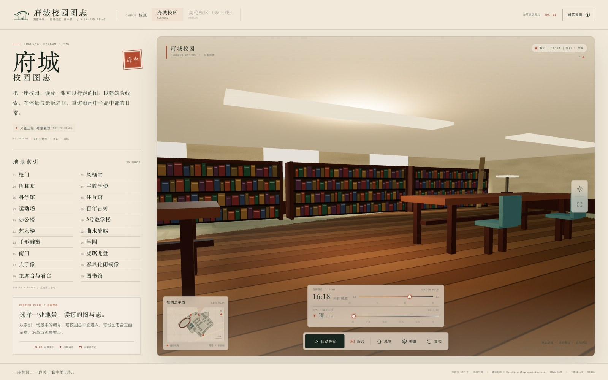 | 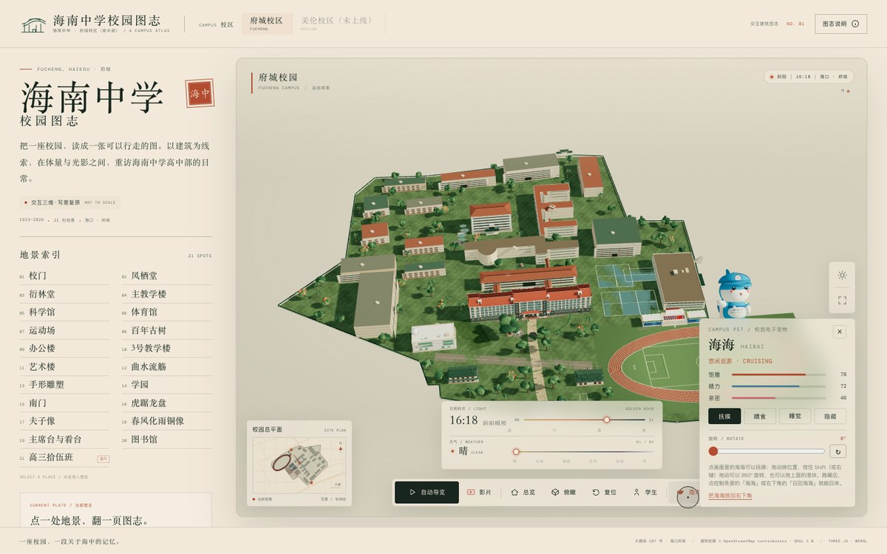 |
| **Night** | **Snow** |
| 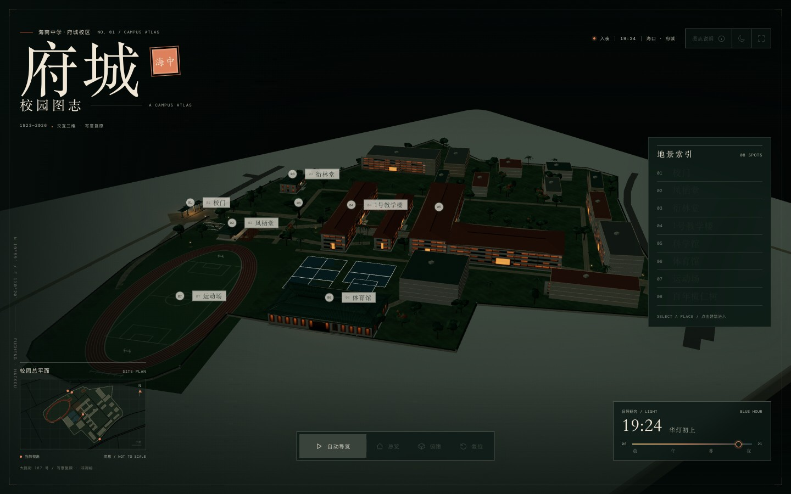 | 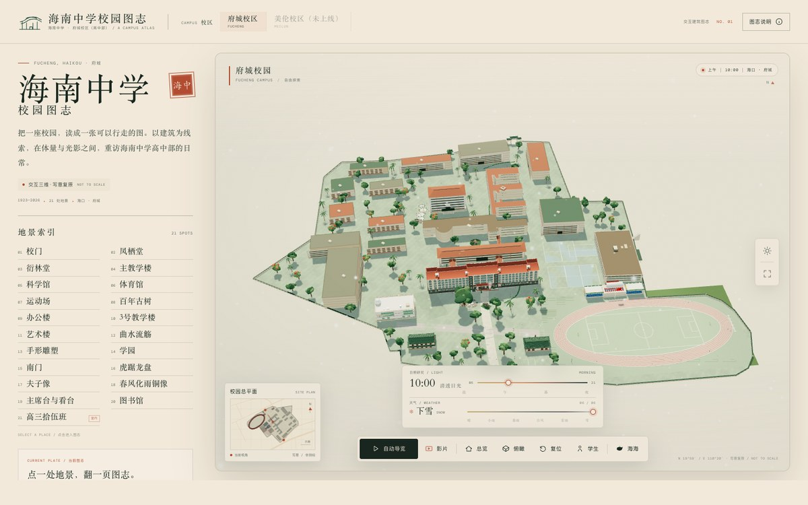 |

Every landmark page includes a real photograph (see "Site photographs" below).

## Campus film

A ~74-second cinematic tour: aerial descent into campus → North Gate → Fengqi Hall exterior → Main Teaching Building (lobby / corridor / Senior 3, Class 15) → Library (exterior / reading room) → Science Hall and Art Building → Gymnasium / grandstand / sports field → ascent finale. Play it from the "Film" button at the bottom of the page, or record and download a WebM.

[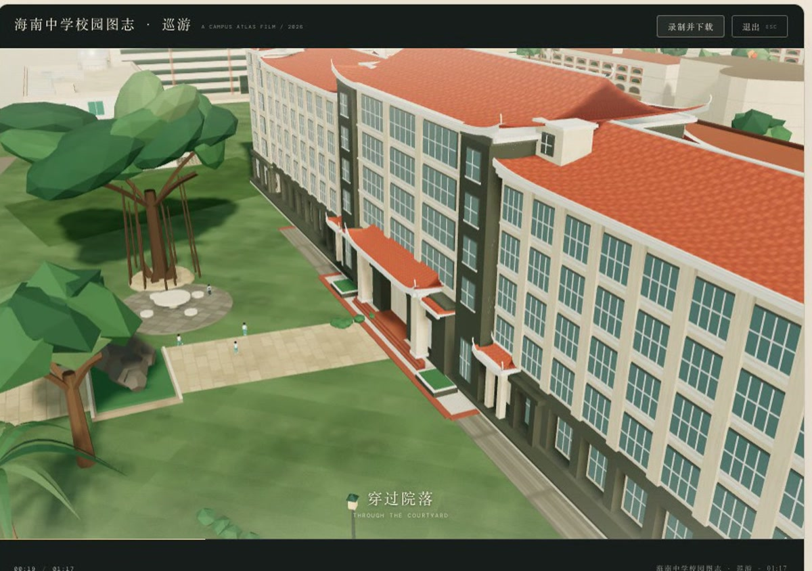](assets/preview/campus-tour.mp4)

## Quick start

```bash
# Open directly: double-click hainan-middle-school.html (self-contained, no network needed)
npm install
npm run serve      # dev server at http://127.0.0.1:8080/ (HTTP required; ES Modules + import map)
npm run build      # rebuild the self-contained single-file version
npm run shots      # visual-regression gate (shots:update to rebuild baselines)
```

URL parameters: `?campus=fucheng` · `?spot=fengqi` · `?spot=classroom` · `?hour=19.6` · `?view=top` · `?film=1` · `?weather=snow`; development parameters: `?still=1&nointro=1`, `?env=off`, `?detail=off`, `?pet=on/off`.

## Site photographs

Each of the 21 landmarks has a real photograph in its atlas card on the left; "SITE PHOTO" marks a direct photograph of that landmark, while "REFERENCE" marks a comparable view in the same area or of the same building type (for example, the South Gate currently has no public close-up and uses the matching North Gate as a reference).

- Main sources: the Hainan Middle School official campus gallery (2013, photographed by Chen Xiaoxiong), Bilibili centennial celebration films and *Aerial Hainan Middle School* (2023), and *Hainan Middle School!! From a God's-Eye View* (2018).
- Photograph copyrights remain with the original photographers and the school. They are used here only for unofficial campus reading and historical comparison, not for commercial distribution; please contact us for removal if there is a rights issue.
- Photographs are inlined into the single-file build and remain visible offline; in the development version they live under `assets/photos/`.

## Documentation

> Project documentation is currently written in Chinese.

- **Features & implementation**: [Features](docs/features.md) · [Companion](docs/pet.md) · [Development & build](docs/contributing.md) · [Repository structure](docs/structure.md)
- **Accuracy & design**: [Accuracy and evidence](docs/accuracy.md) · [Design notes](docs/design-notes.md) · [Changelog](docs/changelog.md)
- **Engineering tools**: [Visual regression](docs/visual-regression.md) · [Multi-campus extension](docs/campuses.md)
- **Research**: [AI-generated 3D web games](docs/ai-generated-3d-games.md) · [Video-based building reconstruction](docs/ai-video-reconstruction.md)

## Notes

- **Data and assets**: campus geometry is based on [OpenStreetMap](https://www.openstreetmap.org/way/1127981105) (© OpenStreetMap contributors, [ODbL 1.0](https://opendatacommons.org/licenses/odbl/1-0/)); fonts are under SIL OFL 1.1; preview images and the campus film are rendered by this project.
- Rights to the school name and marks such as "海中" belong to the school. For official promotion, guided tours, or spatial decisions, please rely on the school's official materials and surveyed drawings.
