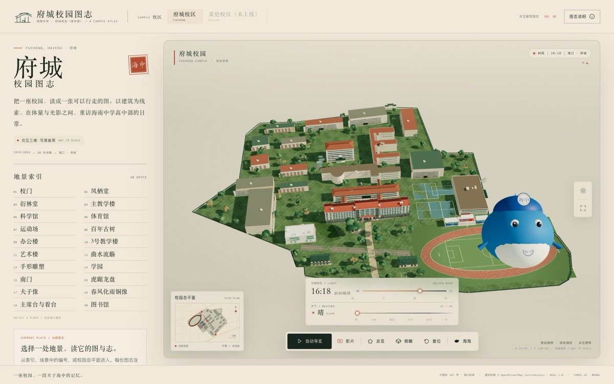
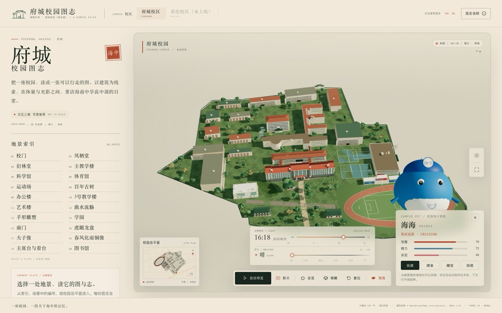

# 电子宠物「海海」· 实现说明

> 海南中学校园吉祥物虎鲸「海海」的程序化三维电子宠物，嵌在校园图志页面里。形象为根据公开吉祥物资料（蓝色虎鲸、白色肚皮、校徽棒球帽）的**写意程序化还原**，非官方素材。

| 画面里的海海 | 宠物面板 |
| --- | --- |
|  |  |

## 技术构成

| 能力 | 实现 | 说明 |
|---|---|---|
| 三维形象 | `js/pet.js`：Three.js 基础几何（球体/圆锥/圆柱/管）拼装 | 身体、白肚皮、背鳍、尾鳍、胸鳍、眼睛、腮红、嘴、棒球帽、校徽 |
| 贴图 | Canvas 2D 程序化绘制校徽、爱心 | 零外部素材，校徽贴图缓存在内存 |
| 光照 | 复用场景的太阳/半球光与 PMREM 环境反射 | 宠物自动获得与校园一致的昼夜色温 |
| 动画 | 手写程序化动画（无骨骼/无动画文件） | 呼吸漂浮、摆尾、眨眼、帽子轻晃、被抚摸时弹跳+转圈+爱心 |
| 交互拾取 | `THREE.Raycaster` 对宠物 group 做命中测试 | 点击画面里的海海即可抚摸；与建筑拾取共用一套指针坐标 |
| 状态机 | 饱腹 / 精力 / 亲密三轴 + 睡眠 | 按真实时间衰减，睡觉回复精力，状态决定表情与语气 |
| 持久化 | `localStorage`（`hainan-pet-haibai-v1`） | 记录三轴数值、是否睡觉、是否隐藏、最后在线时间；离线也会衰减（上限 3 天） |
| 声音 | WebAudio 双音 chirp | 抚摸/喂食时合成短音，无音频文件；失败不影响功能 |
| UI | `index.html` 面板 + `css/style.css` | 桌面右下角卡片，移动端压成底部横条；dock 增加「海海」按钮 |

## 交互

- 点击画面里的海海（或面板「抚摸」）：亲密 +7，消耗少量精力，出现弹跳/爱心。
- 「喂食」：饱腹 +20、精力 +4，4 秒冷却。
- 「睡觉 / 叫醒」：切换睡眠；睡眠时精力回复加快、饥饿衰减变慢。
- 「隐藏 / 海海按钮」：隐藏后 3D 宠物消失，再点 dock 按钮恢复。
- 播放巡游影片时宠物自动隐匿，退出后恢复。
- 状态每 2 秒左右自动保存；页面隐藏 / 关闭时再存一次。换设备不共享（存本机）。

## 确定性（视觉回归）

- `?still=1`（`npm run shots` 使用）：宠物使用固定初始数值、不读/写存档、不按时间衰减，只参与单帧渲染，保证截图可复现。
- `?pet=off`：隐藏宠物，便于拍干净的校园图；`?pet=reset`：清空存档重新开始。
- 移动端与桌面端使用同一套逻辑，仅布局位置与尺寸不同。

## 文件

- `js/pet.js`：建模、动画、状态、持久化、点击命中、音效。
- `js/main.js`：`createPet()` 装配、渲染循环更新、点击/悬停接入、面板 UI。
- `index.html`：dock「海海」按钮 + 宠物面板结构。
- `css/style.css`：宠物面板样式与移动端布局。

## 还可以继续做

- 更多动作：跟随视角、在校园里短途巡游、下雨时打伞、夜间打哈欠。
- 成长线：连续登录、校史问答换「小鱼干」、图志打卡喂养。
- 拍照分享：把海海与当前视角合成一张明信片。
- 多吉祥物 / 换装（校服、雨衣、校庆围巾）。
