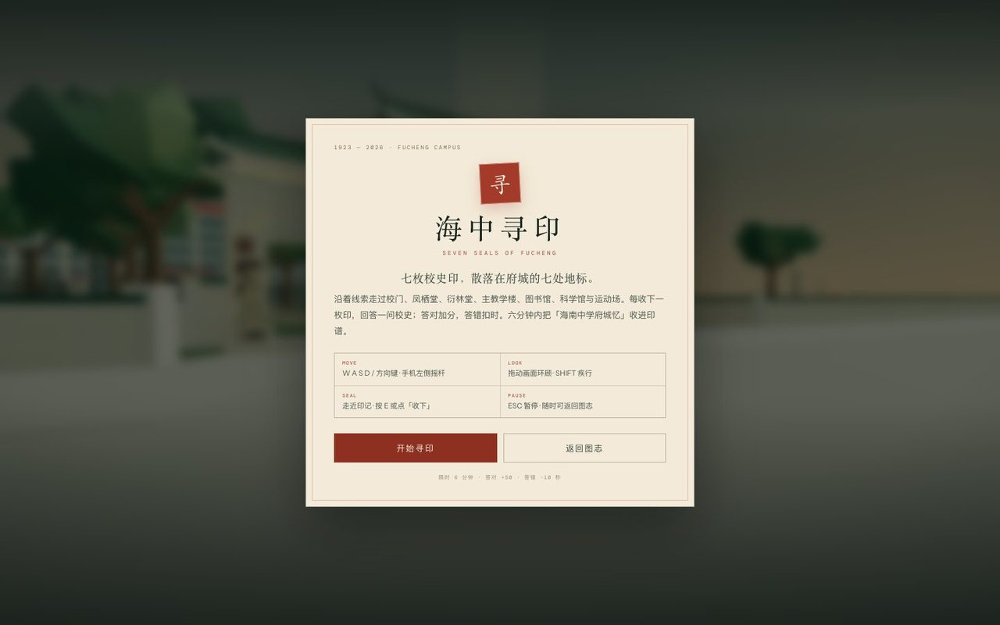
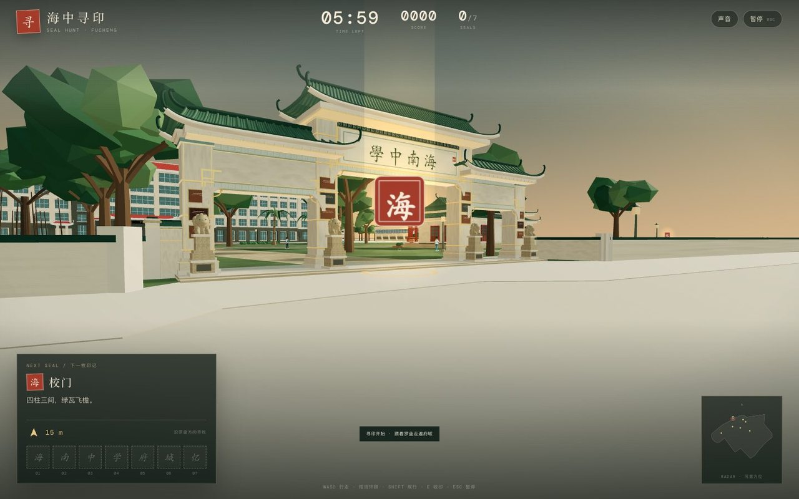
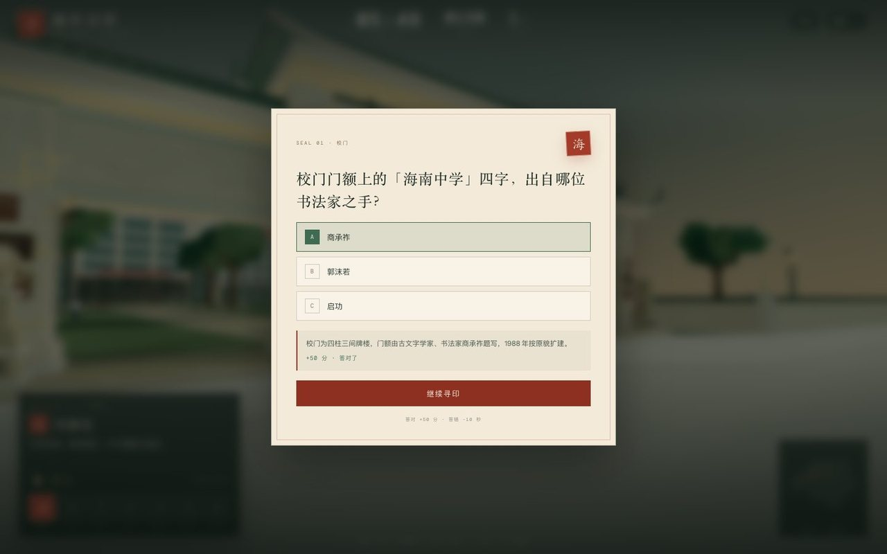
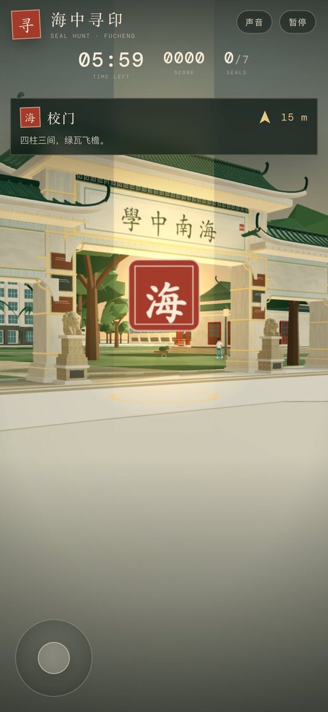
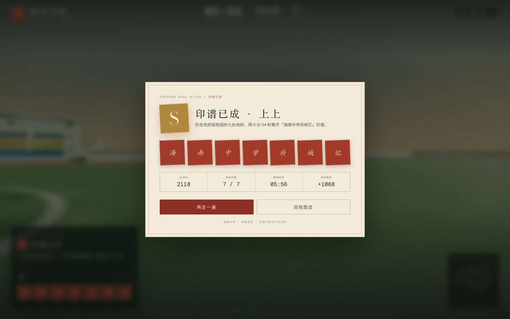

# 海中寻印 · 校园寻宝

**海南中学校园图志的可玩番外**  
方案介绍 · v0.1 · 2026-11

> 用六分钟，走进府城校园，集齐七枚校史印，把「海南中学府城忆」收进印谱。

[完整游戏方案](design.md) · [精度与证据](../docs/accuracy.md) · [返回图志](../README.md)

## 一分钟看懂

| 项目 | 结论 |
| --- | --- |
| 类型 | 第一人称校园寻宝 + 校史问答 |
| 一局 | 6 分钟 · 7 枚印 · 7 问 |
| 平台 | 桌面与手机浏览器，无需安装 |
| 入口 | 图志控制条「寻印」，或 `?game=1` |
| 内容 | 校门、凤栖堂、衍林堂、主教学楼、图书馆、科学馆、运动场 |
| 成本 | 零外部素材；MVP 约 2–3 周 |
| 定位 | 图志的番外，不替代主页面 |

## 为什么做

图志已经能看、能读、能飞，但访客始终是「在外面看」。校园最动人的部分，是走进去之后发生的：从北门到主楼的那条轴线、凤栖堂前的树荫、运动场边的一圈红色。

《海中寻印》把现有的 21 处地景变成一条可以行走的路线，用七枚校史印把「看建筑」变成「找线索、读校史、走完一圈」。它不新增一座建筑，也不改变图志的阅读方式，只是在图志旁边开一扇门。

- **内容已经存在**：建筑、照片、史实、天气、学生、室内机位都在仓库里；
- **交互成本很低**：不需要新模型、新贴图、新音频，全部程序化；
- **传播性强**：一局六分钟，有成绩、有印谱、有证书，适合校庆、开放日和校友转发。

## 玩什么

1. **从北门出发**。第一人称走进校园，左侧摇杆或 WASD 行走，拖动画面环顾。
2. **跟着罗盘找印**。HUD 给出下一枚印的线索、方向与距离；靠近后按 `E` 或点「收下」。
3. **回答一问校史**。每收一枚印，回答一道三选一；答对加分，答错扣 10 秒，并读到一条出处明确的校史注脚。
4. **集齐七枚印**。七枚印合起来是「海南中学府城忆」；六分钟内完成，得到印谱、评级与一张可保存的证书。

一局的核心节奏是：**走 → 找 → 收 → 读 → 下一枚**。30 秒一个小目标，6 分钟一局，不打断图志的阅读气质。

## 七枚印

| 印 | 地标 | 线索 | 校史一问 |
| --- | --- | --- | --- |
| 海 | 校门 | 四柱三间，绿瓦飞檐 | 门额四字出自哪位书法家？ |
| 南 | 凤栖堂 | 红柱白墙，绿琉璃瓦 | 凤栖堂建成于哪一年？ |
| 中 | 衍林堂 | 以首任校长为名 | 堂名取自谁？ |
| 学 | 主教学楼 | 五段红瓦屋面、三间石柱门廊 | 楼前太湖石题名是什么？ |
| 府 | 图书馆 | 三层白瓷砖、银色穹顶 | 屋顶右端的标志是什么？ |
| 城 | 科学馆 | 弧形横窗、玻璃楼梯间 | 最醒目的立面特征是什么？ |
| 忆 | 运动场 | 一圈红土色 | 直道边、校庆主会场是？ |

七枚印的首字连起来是「海南中学府城忆」。每道题的答案都能在 [地景数据](../js/data.js) 与 [精度文档](../docs/accuracy.md) 里找到出处，不另编史实。

## 界面

| 走进去 | 校史一问 |
| --- | --- |
|  |  |

| 手机端 | 印谱结算 |
| --- | --- |
|  |  |

> 以上为界面示意，用于说明气质与信息层级；结算数值为测试数据。

## 与图志的关系

- **番外，不是替代**：主页面仍是图志；游戏是控制条里的一个入口，随时可以退出，退出后相机与日照原样恢复。
- **每枚印都能回到图志（v1）**：收印后的问答卡可以继续打开该地标的图志页，读建筑、看实景照片。
- **共用一套事实**：题目、线索、照片、年代全部来自现有地景数据，避免「游戏设定」和「图志文案」两套说法。
- **保持克制**：没有战斗、没有敌人、没有失败羞辱；只有时间、路线和一段校史。

## 适合谁

| 人群 | 场景 | 他们得到什么 |
| --- | --- | --- |
| 校友 | 校庆、校友日、远程重访 | 一条熟悉的路线，一次「走回教室」的机会 |
| 新生与家长 | 开放日、入学教育 | 在一局之内认识七处最重要的校园地标 |
| 访客与公众 | 城市文化、校园导览 | 一张可以走完的校园文化地图 |
| 学校与校史馆 | 大屏、展厅、校庆摊位 | 可计分、可合影、可排队的轻量互动 |

## 气质与边界

- **纸感、朱砂、深绿**：HUD 用半透明深绿玻璃，印面用朱砂，文字用宋体与等宽字；不做霓虹、不做写实枪械。
- **不制造焦虑**：限时是节奏，不是惩罚；另有「慢游模式」可以关掉计时（v1）。
- **非官方项目**：延续图志的声明；不用于导航、测量或校园空间决策。

## 现在到哪一步

本轮**只交付方案与介绍，不包含游戏代码**。此前做过一次内部技术验证（第一人称行走、七枚印、问答、结算、手机摇杆均已跑通），验证代码不随本次提交，截图仅作为界面示意。

下一步需要评审拍板：

1. 是否立项，以及 MVP 是否就做「七枚印 + 六分钟」；
2. 入口放在控制条还是单独页面；
3. 是否需要排行榜 / 校庆大屏模式；
4. 校史题由谁做最终审校；
5. 是否需要英文版与分享证书。

## 成本与风险

| 项目 | 估计 |
| --- | --- |
| MVP（七枚印、计时、问答、结算、桌面 + 手机） | 约 13–16 人日，单人 3 周内 |
| 内容审校 | 与开发并行，约 2–3 人日 |
| 外部素材 | 0；印章、光柱、音效均程序化生成 |
| 单文件增量 | 预计 gzip +20–30 KB |
| 主要风险 | 校史事实校验、移动端操作、晕动、与图志气质的平衡 |

更完整的范围、排期、指标与技术方案见 [design.md](design.md)。
