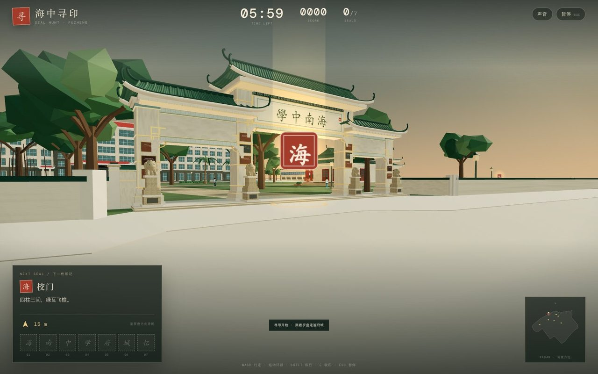
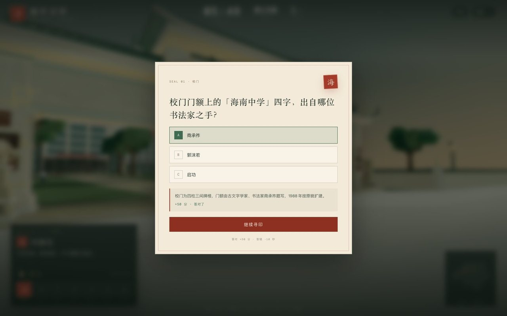
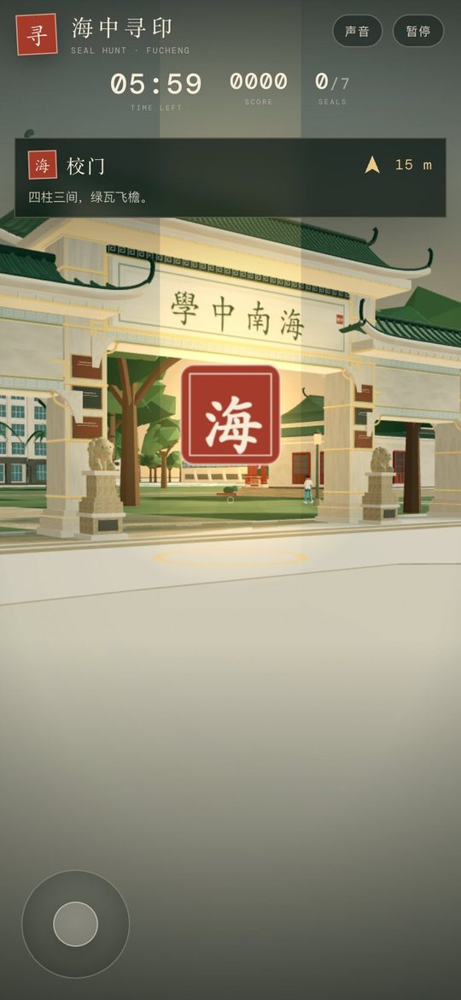

# 《海中寻印》· 游戏方案

**海南中学校园图志的可玩番外**  
完整设计文档 · v0.1 · 2026-11

> 用六分钟，走进府城校园，集齐七枚校史印，把「海南中学府城忆」收进印谱。

- 对外介绍：[README.md](README.md)
- 精度边界：[../docs/accuracy.md](../docs/accuracy.md)
- 技术背景：[../docs/ai-generated-3d-games.md](../docs/ai-generated-3d-games.md)

---

## 0. 结论摘要

**建议：立项，但只做一个小而完整的 MVP。**

| 判断 | 结论 |
| --- | --- |
| 值不值得做 | 值得。图志已有 21 处地景、4 座重点建筑、2 处室内、天气与学生行为；缺的只是「走进去」的理由，边际成本低。 |
| 做多大 | 第一版只做 7 枚印、6 分钟、7 道校史题，不做排行榜、不做多人、不做战斗。 |
| 做多久 | 单人约 13–16 人日（3 周内）；内容审校并行 2–3 人日。 |
| 风险 | 校史事实校验、移动端操作、晕动，以及与图志「克制」气质的平衡。 |
| 形态 | 图志控制条新增「寻印」入口，`?game=1` 直达；不替代主页面，退出即恢复原机位与日照。 |

内部已完成一次技术验证：第一人称行走、七枚印收集、校史问答、计时结算、手机摇杆均可运行。验证代码不随本次提交，本文保留其结论用于评估。

---

## 1. 产品定位

### 1.1 现状

图志已经解决了「看」的问题：

- 21 处地景、编号、图志卡与实景照片；
- 校门、主教学楼、凤栖堂、衍林堂等重点建筑的米制复原；
- 主教学楼门厅/走廊/教室、图书馆阅览室两处室内；
- 昼夜、六种天气、学生行走与跑步、电子宠物海海；
- 自动导览、巡游影片、小地图、分享参数。

它仍然是一个**观看型**产品：访客拖动、缩放、点击，然后读文字。校园的尺度感、路线感和「走进去」的经验，是目前的空白。

### 1.2 机会

《海中寻印》把「图志」变成「一条可以走完的路线」：

- **空间**：第一人称进入校园，用脚丈量从北门到运动场的距离；
- **内容**：七枚印对应七处地标，每枚印解锁一条校史与一张图志页；
- **目标**：六分钟内集齐「海南中学府城忆」，得到印谱与评级；
- **气质**：纸感、朱砂、深绿，不做成通用射击或闯关游戏。

### 1.3 不做什么

| 不做 | 原因 |
| --- | --- |
| FPS / 战斗 / 敌人 | 与校园图志的定位冲突，且会引入不必要的内容与审核风险 |
| 开放世界 / 载具 | 场景只有一座校园，规模不匹配 |
| 多人联机 / 账号体系 | MVP 不需要，增加后端与隐私成本 |
| 校园经营 / 养成 | 内容量大，且偏离「阅读校园」的初衷 |
| AR / 定位 | 硬件、权限与室外使用门槛高 |
| 排行榜（首版） | 会诱导刷分与焦虑，先验证完成率与体验 |

### 1.4 产品边界

- 是图志的**番外**，不是替代；主页面、导览、影片、学生视角、海海都保留；
- 是**非官方**数字文化项目，延续图志的精度声明；
- 不用于导航、测量或校园空间决策；
- 不采集个人身份信息；成绩只存本机。

---

## 2. 用户与场景

| 人群 | 典型场景 | 核心诉求 | 设计回应 |
| --- | --- | --- | --- |
| 校友 | 校庆、校友日、远程重访 | 走回熟悉的路线，找回记忆 | 七处最有记忆点的地标；校史问答；证书 |
| 新生与家长 | 开放日、入学教育 | 快速认识校园 | 6 分钟走完主轴线；罗盘与线索降低迷路 |
| 访客与公众 | 城市文化、校园导览 | 一张可读、可走的校园地图 | 图志卡与实景照片；非官方声明 |
| 学校与校史馆 | 大屏、展厅、校庆摊位 | 可参与、可合影、可排队 | 计时局、评级、证书；后续可做 kiosk |
| 老师 | 校史/地理/语文跨学科活动 | 有出处的校史素材 | 每道题附注脚与来源；可导出题目 |

**使用设备**：桌面（鼠标 + 键盘）与手机（触屏）为主；校庆大屏可横屏 + 手柄式触控。

---

## 3. 参考与取舍

### 3.1 参考对象

- **《Saltline》/ AI 生成 3D 网页游戏**：证明「零素材 + 程序化 + 单场景」可以在浏览器里做出完整体验；但它的 FPS 战斗与写实港区不适合本图志。技术结论已整理在 [ai-generated-3d-games.md](../docs/ai-generated-3d-games.md)。
- **校园寻宝 / 博物馆寻宝**：低成本、高参与、易解释；缺点是容易变成「点一点」。
- **校园导览 App**：内容深，但缺少「走」的乐趣与完成感。

### 3.2 候选玩法对比

| 方案 | 成本 | 与图志的契合 | 风险 | 结论 |
| --- | --- | --- | --- | --- |
| **A. 第一人称校园寻印** | 中低 | 高：空间、建筑、校史 | 移动端操作、晕动 | **推荐** |
| B. 纯点击式解谜 | 低 | 中：仍是「看」 | 缺少尺度感，容易腻 | 备选 |
| C. 校园经营/养成 | 高 | 低：偏离阅读 | 内容量大、维护重 | 不做 |
| D. FPS/闯关 | 中 | 低：气质冲突 | 审核、品牌、晕动 | 不做 |
| E. AR 实景寻宝 | 高 | 中 | 硬件、权限、室外 | 暂不做 |

### 3.3 取舍原则

1. **先做空间，再做系统**：先让「走进去」成立，再加计时、问答、证书。
2. **内容复用，不新造资产**：所有印章、光柱、音效程序化生成。
3. **一局完整，胜过十个半成品**：MVP 只有七枚印，但每一步都可交付。
4. **不打断图志**：游戏是入口，不是重写。

---

## 4. 核心体验

### 4.1 四个设计支柱

**走进去**  
第一人称、真实尺度（1 场景单位 ≈ 2 m）、可以看到同学、树影、屋檐。不是俯瞰模型，而是站在校门下抬头。

**读得懂**  
每枚印不是「收集品」，而是一页校史：收印 → 一问 → 一条注脚 → 一张图志页。玩完至少记住七个事实。

**有克制**  
没有血条、没有击杀、没有连击。HUD 只有时间、分数、印数、线索与罗盘；视觉延续图志的纸感与朱砂。

**可分享**  
一局结束有一张「府城印谱」证书：七枚印、评级、用时、答对题数。适合校庆合影、朋友圈、班级活动。

### 4.2 情绪曲线

| 时间 | 玩家状态 | 设计动作 |
| --- | --- | --- |
| 0:00 | 好奇 | 北门开场，第一枚「海」印就在门洞下 |
| 0:30 | 进入节奏 | 罗盘指向凤栖堂，路线沿中轴展开 |
| 2:00 | 熟悉 | 已收 3 枚，开始读题、记住注脚 |
| 4:00 | 有点紧张 | 剩余时间提示，运动场一段最长 |
| 5:30 | 冲刺 | 最后一枚「忆」，印谱将齐 |
| 6:00 | 完成/遗憾 | 证书或「还差一枚」，可再来一局 |

---

## 5. 玩法循环

### 5.1 三层循环

```
30 秒：看见线索 → 走向印记 → 收下 → 读一条校史
 6 分钟：七枚印 → 印谱 → 评级 → 证书
   长期：慢游全图志 / 每日一印 / 校庆榜 / 新校区
```

### 5.2 一局流程

1. **开场**：北门外，镜头面向校门；教学卡说明「六分钟、七枚印、一问一答」。
2. **行走**：WASD / 方向键 / 左摇杆；Shift 疾行；拖动画面环顾。
3. **导航**：HUD 显示最近一枚未收集印的线索、方向、距离；目标印有一道柔和光柱。
4. **收印**：进入 6 单位（约 12 m）范围，按 `E` 或点「收下」。
5. **问答**：三选一；答对 +50 分，答错 −10 秒；展示注脚与出处。
6. **继续**：印谱格点亮，罗盘指向下一枚。
7. **结算**：七枚齐 → 时间奖励 → 评级 → 证书；时间到 → 显示还差几枚，可重来。

### 5.3 推荐路线与自由度

推荐顺序：**北门 → 凤栖堂 → 衍林堂 → 主教学楼 → 图书馆 → 科学馆 → 运动场**。

但玩家可以自由收集：罗盘永远指向**最近的未收集印**，不强制顺序。推荐顺序只用于文案与证书排序。

按推荐顺序的步行距离约 **650 m**（场景坐标 327 单位 × 2 m），快步 2–3 分钟，留 3–4 分钟找印、读题、拍照。六分钟是「紧但可完成」的节奏。

### 5.4 模式

| 模式 | 时长 | 说明 | 版本 |
| --- | --- | --- | --- |
| 寻印（默认） | 6 分钟 | 七枚印 + 计时 + 评级 | MVP |
| 慢游 | 不限时 | 去掉计时与扣时，适合新生/家长 | v1 |
| 校庆场 | 6 分钟 | 大屏 kiosk、本地榜单、一键重开 | v2 |
| 主题场 | 6 分钟 | 雨夜/黄昏/雪景，换一套线索文案 | v2 |

---

## 6. 内容设计

### 6.1 七枚印

| 印 | 地标 | 线索（HUD） | 校史一问 | 答案 | 注脚 |
| --- | --- | --- | --- | --- | --- |
| 海 | 校门 | 四柱三间，绿瓦飞檐 | 门额「海南中学」四字出自谁？ | 商承祚 | 古文字学家、书法家商承祚题写；1988 年按原貌扩建 |
| 南 | 凤栖堂 | 红柱白墙，绿琉璃瓦 | 凤栖堂建成于哪一年？ | 1934 年 | 1934 年 9 月建成，旅泰华侨韩裕准捐资，以其父韩凤栖命名 |
| 中 | 衍林堂 | 以首任校长为名 | 堂名取自谁？ | 首任校长钟衍林 | 门前有「春风化雨——钟衍林和学生们」铜像 |
| 学 | 主教学楼 | 五段红瓦屋面、三间石柱门廊 | 楼前太湖石题名？ | 虎踞龙盘 | 93 吨太湖石，2012 年立，位于校门至主楼轴线 |
| 府 | 图书馆 | 三层白瓷砖、银色穹顶 | 屋顶右端标志？ | 银色金属穹顶 | 横向绿色玻璃窗带、首层绿色雨棚柱廊 |
| 城 | 科学馆 | 弧形横窗、玻璃楼梯间 | 最醒目的立面特征？ | 弧形横窗与玻璃楼梯间 | 浅色横带与深色窗带交替，入口有绿色雨棚 |
| 忆 | 运动场 | 一圈红土色 | 直道边、校庆主会场是？ | 主席台与看台 | 蓝黄阶梯看台，校运会与校庆主会场 |

七枚印首字连读：**海南中学府城忆**。

### 6.2 线索文案规则

- 每条线索是一句**可观察**的建筑特征，不是谜语；玩家抬头就能对上。
- 不写「前往东南方向」这类方位题，方位交给罗盘。
- 每条线索 <= 24 字，手机上一行显示。
- 线索直接复用图志 `summary`，保证游戏与图志同一套说法。

### 6.3 题库规则

- 题目只问**图志已收录、有出处**的事实；不编年代、不编人物。
- 选项三个，一个正确；干扰项来自同类地标（书法家/校长/构件），不做明显搞笑项。
- 答错也展示注脚，让「错」也有收获。
- MVP 每题 1 问；v1 每题 3 问随机抽，降低背题。
- 所有题目在 `game/` 文档与 `js/data.js` 之间保持可追溯。

### 6.4 印谱与证书

**印谱**：七个朱砂方格，未收集为虚线，收集后填朱砂、微微旋转，像真的盖上去。

**证书**（结算页）：

- 标题：印谱已成 / 时间到；
- 评级章：S / A / B / 未；
- 七枚印排成一行；
- 数据：总分、答对题数、剩余时间、时间奖励；
- 日期与「海南中学 · 府城校区 · 非官方数字文化项目」；
- 操作：再走一遍 / 回到图志。

后续可加「保存为图片」，用于校庆合影与分享。

### 6.5 内容扩展

| 版本 | 内容 |
| --- | --- |
| MVP | 7 枚印、7 问、1 条推荐路线 |
| v1 | 21 枚印（全部地景）、每题 3 问、慢游模式、图志互链 |
| v2 | 每日一印、校庆榜、主题场、海海向导、分享证书 |
| 未来 | 多校区路线、班级对抗、校史策展人模式 |

---

## 7. 系统与数值

### 7.1 行走与碰撞

- 场景单位：1 单位 ≈ 2 m；视高 0.9 单位（1.8 m）。
- 行走 2.7 单位/秒（5.4 m/s），疾行 4.5 单位/秒（9 m/s）。
- 碰撞用 `site.buildings` 的**二维建筑轮廓**（24 个），而不是 Three.js 网格 AABB；主教学楼、科学馆是斜向拼联体量，AABB 会把前场填死。
- 玩家半径 0.3 单位；点到多边形边距离小于半径即阻挡；轴分离移动，可贴墙滑行。
- 校门是牌楼开口，碰撞不包整组；门洞可通行。
- 场景边界用矩形钳制；不做重力、跳跃、攀爬。

### 7.2 计时与得分

| 事件 | 数值 |
| --- | --- |
| 初始时间 | 360 秒 |
| 收一枚印 | +100 分 |
| 答对 | +50 分 |
| 答错 | −10 秒 |
| 时间奖励 | 剩余秒数 × 3 |
| 满分 | 约 2,130 |
| 超时 | 结束本局，显示还差几枚 |

### 7.3 评级

| 评级 | 条件 |
| --- | --- |
| S | 集齐 7 枚、答对 7 题、剩余 ≥ 120 秒 |
| A | 集齐 7 枚、答对 ≥ 5 题 |
| B | 集齐 7 枚 |
| 未 | 未集齐 |

S 是「又快又准」；A 是「走完且读懂了」；B 是「走完了」。不以答错羞辱玩家。

### 7.4 导航

- **罗盘**：HUD 内箭头，指向最近未收集印；同时显示直线距离（米）。
- **光柱**：目标印上方一道柔和光柱，远处可见；只对目标显示，避免全图发光。
- **雷达**：桌面端右下角小雷达，显示校园轮廓、七印、玩家朝向；手机端隐藏，靠罗盘。
- **提示**（v1）：点海海给一句提示，扣 20 分；MVP 不做，避免打断节奏。

### 7.5 音频

- WebAudio 实时合成，无音频文件；
- 收印：两声上行；答对：三音琶音；答错：低音；结算：四音和弦；
- 默认开启，可一键静音，状态存本机；
- 移动端首次点击「开始寻印」时创建 AudioContext，符合浏览器手势策略。

### 7.6 存档

- 本机 `localStorage`：静音状态、最佳分数、最佳用时；
- 不存身份信息、不上传；
- 换设备/清缓存即重置；v2 如需榜单再引入轻量后端。

### 7.7 无障碍

- 全键盘可完成：WASD/方向键、E 收印、Esc 暂停、Enter 继续；
- 触屏：左摇杆 + 右侧拖动 + 「收下」按钮；
- `prefers-reduced-motion`：关闭光柱脉动、提示浮动、出发闪字；
- 可关闭头部晃动（默认极轻）；
- 对比度：纸色文字/深绿底；不依赖颜色单独传达信息（答对/错同时有文字）；
- 提供「慢游」模式，避免时间压力。

---

## 8. 界面与美术

### 8.1 视觉语言

| 元素 | 规则 |
| --- | --- |
| 底色 | 暖纸 `#f3ead9`；HUD 深绿玻璃 `rgba(9,20,15,.72)` |
| 强调 | 朱砂 `#a33a2a`；金 `#e9c785` |
| 字体 | 宋体标题、DM Mono 数字、Instrument Sans 正文 |
| 印 | 朱砂方印、纸色阴文、轻微旋转 |
| 动效 | 慢、少、可预期；印面上下浮动 0.12 单位，光柱呼吸 |
| 禁止 | 霓虹、写实枪械、夸张爆炸、连续闪白 |

### 8.2 HUD 信息层级

```
顶部：海中寻印 / 倒计时 / 分数 / 印数 / 静音 / 暂停
中央：准星（靠近印时变朱砂）
左下：下一枚印的线索、罗盘、距离、七印印谱
右下：雷达（桌面）
底部：E 收下（靠近时）
```

### 8.3 手机布局

- 顶部：品牌 + 倒计时 + 印数；
- 其下：一条紧凑线索（印名 + 线索 + 罗盘 + 距离）；
- 底部左：摇杆；底部中：收下按钮；
- 雷达、键盘提示隐藏；
- 大字、可点区域 ≥ 44 px。

### 8.4 界面示意









> 示意图中的结算数值为测试数据；正式版会显示真实用时与得分。

### 8.5 性能预算

- 新增 7 个印章 Sprite、7 个地面圆环、1 个目标光柱；无新增模型与贴图文件；
- 碰撞每帧约 24 个多边形、百余条边，开销可忽略；
- HUD 为 DOM，雷达 10 fps 重绘；
- 目标：桌面 60 fps、移动端 ≥ 30 fps；p95 帧时间 ≤ 33 ms。

---

## 9. 技术方案

### 9.1 复用

| 现有能力 | 用途 |
| --- | --- |
| Three.js 场景 `js/campus-accurate.js` | 校园、建筑、学生、树、灯光 |
| `js/site.js` 建筑轮廓 | 行走碰撞 |
| `js/data.js` 地景文案 | 线索、题目、注脚 |
| 相机/OrbitControls | 进入前保存，退出恢复 |
| 学生视角代码 | 第一人称相机与视高的参考 |
| 天气/昼夜 | 开局设为斜阳；退出恢复原时刻 |
| 电子宠物海海 | 游戏中隐藏；v1 作为提示向导 |
| 构建脚本 `build.mjs` | 单文件版自动内联 |

### 9.2 新增模块

```
js/game.js          游戏状态机、行走、印章、问答、结算、音频
index.html          游戏 HUD 与四个弹层（开场/问答/暂停/结算）
css/style.css       游戏样式（约 700 行）
js/main.js          入口、模式切换、相机/输入分流
```

### 9.3 状态机

```
idle → intro → playing ⇄ paused
                   ↓
                 quiz → playing
                   ↓
                result → playing（再来一局）/ idle（退出）
```

- `active`：游戏是否接管；
- `running`：本局是否计时；
- `paused` / `quizOpen` / `resultOpen`：暂停计时与移动；
- 退出时：停影片 / 学生视角、隐藏宠物，恢复相机、FOV、OrbitControls 与日照时刻。

### 9.4 输入与相机

- `main.js` 在 `state.gameActive` 时把键盘、指针、点击分流给 `game`；
- 游戏禁用 OrbitControls，接管相机；
- 退出时恢复进入前的 `position/quaternion/fov/target` 与 `controls.enabled`；
- `?game=1` 自动进入开场；控制条「寻印」按钮同效。

### 9.5 印章与交互

- 每枚印：Canvas 印章贴图 + Sprite + 地面圆环 + 光柱 + 放大点击球；
- 点击球用透明材质，手机点印更容易；
- 收印判定：XZ 距离 ≤ 6 单位；不要求精确对准；
- 收印后播放 0.55 s 缩放消失动画，再弹问答；
- 问答期间暂停计时与移动。

### 9.6 构建与回归

- 构建：`npm run build` 生成单文件版；预计 gzip +20–30 KB；
- 回归：`npm run shots` 确保默认图志逐像素不变；
- 新增测试：7 枚印可达性、问答对错、暂停/退出/重开、手机摇杆、`?game=1`；
- 开发参数：`?game=1&nointro=1` 快速进入。

### 9.7 代码量估计

| 部分 | 估计 |
| --- | --- |
| `js/game.js` | 1,300–1,600 行 |
| HTML 弹层 | 150–220 行 |
| CSS | 650–850 行 |
| `js/main.js` 改动 | 80–120 行 |
| 测试脚本 | 150–250 行 |

---

## 10. 范围与排期

### 10.1 版本范围

**MVP（必须）**

- 第一人称行走、碰撞、手机摇杆；
- 7 枚印、7 道题、印谱、计时、得分、评级；
- 开场 / 问答 / 暂停 / 结算四个界面；
- 音效与静音；
- `?game=1` 与控制条入口；
- 默认图志零回归。

**v1（建议）**

- 收印后跳转对应图志页；
- 慢游模式；
- 证书保存为图片；
- 最佳成绩；
- 3 题/印随机；
- 海海提示。

**v2（可选）**

- 21 枚印全地景；
- 校庆 kiosk / 本地榜；
- 每日一印；
- 雨夜/雪景主题；
- 英文版。

**不做**：战斗、多人、账号、UGC、AR。

### 10.2 排期

| 阶段 | 内容 | 人日 |
| --- | --- | --- |
| M0 方案评审 | 本文档、界面示意、范围确认 | 1 |
| M1 垂直切片 | 行走/碰撞/相机、1 枚印、问答、暂停 | 3–4 |
| M2 内容完整 | 7 枚印、题库、印谱、计时、结算 | 4–5 |
| M3 打磨发布 | 手机、音效、无障碍、性能、回归、单文件 | 4–5 |
| 内容审校 | 校史题与注脚逐条核对（可并行） | 2–3 |
| **合计** | 单人 3 周内；审校并行则 2–3 周 | **13–16** |

### 10.3 依赖与前置

- 校史审校人：需要一位熟悉校史的老师/校友最终确认七道题；
- 入口决策：控制条按钮 vs 独立页面；
- 发布形态：继续随单文件版发布，还是独立 `game.html`；
- 若要做证书分享，需要确认校名/校徽的使用边界。

---

## 11. 指标与验证

### 11.1 目标

| 指标 | 目标 | 说明 |
| --- | --- | --- |
| 开场后开始率 | ≥ 70% | 看到开场并点「开始寻印」 |
| 完成率 | ≥ 35% | 集齐 7 枚印 |
| 中位时长 | 5–7 分钟 | 含读题 |
| 答题正确率 | 55–75% | 太低说明题偏，太高说明太简单 |
| 重开率 | ≥ 10% | 结算后再来一局 |
| 证书保存/分享 | ≥ 5% | v1 起 |
| 移动端占比 | ≥ 50% | 验证手机布局 |
| p95 帧时间 | 桌面 ≤ 16.7 ms；手机 ≤ 33 ms | 现场测量 |

### 11.2 埋点（无个人信息）

```
game_intro_view
game_start
seal_collect   { id, index, elapsed }
quiz_answer    { id, correct, elapsed }
game_pause / game_resume
game_finish    { complete, score, correct, remaining }
game_exit      { at }
```

只上报事件名与数值；不采集设备指纹、位置、身份。校内大屏模式可关闭上报。

### 11.3 验证方式

- 5–8 名同事/学生走查：能否在 6 分钟内完成、是否迷路、是否晕；
- 手机真机（iOS/Android 各 2 台）测试摇杆与帧率；
- A/B：有光柱 vs 无光柱；6 分钟 vs 8 分钟；
- 视觉回归：默认页面 `npm run shots` 必须零差异。

---

## 12. 风险与边界

| 风险 | 概率/影响 | 缓解 |
| --- | --- | --- |
| 校史事实错误 | 中/高 | 只用 `js/data.js` 已核文案；审校人逐条确认；答错也展示出处 |
| 移动端操作不适 | 中/中 | 摇杆 + 收下按钮 + 大点击球；真机测试；可关闭疾行 |
| 3D 晕动 | 中/中 | 默认极轻头部晃动；`prefers-reduced-motion` 全关；FOV 68；不加速转 |
| 与图志气质冲突 | 中/中 | 番外入口；纸感 HUD；无战斗；先做小范围试用 |
| 范围膨胀 | 高/中 | MVP 锁死 7 枚印；排行榜/多人进 v2 |
| 性能下降 | 低/中 | 7 Sprite + 24 多边形；移动端隐藏雷达；p95 门控 |
| 版权/标识 | 低/中 | 零外部素材；校名/校徽使用需学校确认；非官方声明 |
| 内容重复 | 低/低 | v1 加题、v2 每日一印与主题场 |

**明确边界**

- 不做导航、测量、校园空间决策依据；
- 不把游戏成绩与真实学生评价挂钩；
- 不在未审校的情况下新增校史叙述；
- 不复制他人游戏代码/素材；技术参考见 [ai-generated-3d-games.md](../docs/ai-generated-3d-games.md)。

---

## 13. 待拍板

1. **是否立项**，MVP 是否就是「七枚印 + 六分钟」？
2. **入口**：控制条「寻印」，还是独立 `game.html` / 独立路由？
3. **限时**：默认 6 分钟，还是默认慢游、限时作为挑战？
4. **排行榜**：首版是否需要？如需要，是本地榜还是校庆 kiosk？
5. **审校**：七道题由谁最终签字？是否允许游戏内引用图志原文？
6. **分享**：证书保存/分享是否进 v1？是否需要英文版？
7. **代码**：本轮验证代码不提交；立项后按本文档重建，还是保留原型继续迭代？

---

## 附录 A · 七道题（完整版）

### A1 校门 · 海

- 题：校门门额上的「海南中学」四字，出自哪位书法家之手？
- 选项：商承祚 / 郭沫若 / 启功
- 答案：商承祚
- 注脚：校门为四柱三间牌楼，门额由古文字学家、书法家商承祚题写；1988 年按原貌扩建。

### A2 凤栖堂 · 南

- 题：凤栖堂建成于哪一年？
- 选项：1934 年 / 1923 年 / 1988 年
- 答案：1934 年
- 注脚：1934 年 9 月建成，旅泰华侨韩裕准捐资，以其父韩凤栖之名命名；2015 年公布为海南省文物保护单位。

### A3 衍林堂 · 中

- 题：「衍林堂」的堂名取自谁？
- 选项：首任校长钟衍林 / 旅泰华侨韩裕准 / 书法家商承祚
- 答案：首任校长钟衍林
- 注脚：门前立有「春风化雨——钟衍林和学生们」铜像。

### A4 主教学楼 · 学

- 题：主教学楼前中轴上的太湖石题名是什么？
- 选项：虎踞龙盘 / 曲水流觞 / 春风化雨
- 答案：虎踞龙盘
- 注脚：九十三吨太湖石，2012 年立，位于校门至主楼轴线上。

### A5 图书馆 · 府

- 题：图书馆屋顶右端的标志性构件是？
- 选项：银色金属穹顶 / 绿琉璃瓦歇山顶 / 四柱三间牌楼
- 答案：银色金属穹顶
- 注脚：三层白瓷砖、横向绿色玻璃窗带、首层绿色雨棚柱廊；位置在图中为推测，见精度文档。

### A6 科学馆 · 城

- 题：科学馆最醒目的立面特征是？
- 选项：弧形横窗与玻璃楼梯间 / 蓝色连续窗带与斜撑 / 三开间石柱门廊
- 答案：弧形横窗与玻璃楼梯间
- 注脚：浅色横带与深色窗带交替，正面玻璃楼梯间上方有凸出的梯房，入口有绿色雨棚。

### A7 运动场 · 忆

- 题：运动场直道边、校庆主会场所在的是？
- 选项：主席台与看台 / 凤栖堂 / 衍林堂
- 答案：主席台与看台
- 注脚：蓝黄阶梯看台，校运会与校庆主会场；场边立国旗旗杆（写意布置）。

---

## 附录 B · 与现有系统的接口

| 接口 | 说明 |
| --- | --- |
| `?game=1` | 直接进入开场 |
| `#gameButton` | 控制条「寻印」入口 |
| `state.gameActive` | 主循环与输入分流标志 |
| `startGame()` / `exitGame()` | 进入/退出，保存与恢复相机、日照 |
| `createGame({ scene, camera, controls, site, landmarks, applyHour, ... })` | 游戏模块工厂 |
| `campus.pickables` | 仅用于视觉/调试，不用于碰撞 |
| `site.buildings[].poly` | 碰撞轮廓 |
| `LANDMARKS[].summary` | HUD 线索 |
| `LANDMARKS[].photo` | 收印后的图志照片 |
| `npm run build` | 单文件内联 |
| `npm run shots` | 默认页面视觉回归 |

**退出时必须恢复**：相机位置/朝向/FOV、OrbitControls 状态与 target、日照时刻、被隐藏的宠物、被暂停的导览/影片/学生视角。

---

## 附录 C · 参考资料

- 项目内：[功能一览](../docs/features.md) · [精度与证据](../docs/accuracy.md) · [设计注记](../docs/design-notes.md)
- 技术调研：[AI 生成 3D 网页游戏](../docs/ai-generated-3d-games.md)
- 地景数据：[js/data.js](../js/data.js)
- 空间数据：[js/site.js](../js/site.js)

> 本文为非官方项目方案，与海南中学无隶属关系；正式用于宣传、导览或空间决策前，请以学校官方资料与实测图纸为准。
